## 2026-08-03

1. [Understanding constraints on primordial mass black holes made of dark matter using fast radio bursts](https://arxiv.org/abs/2607.28704)

    > Fast Radio Burst, Primordial Black Hole, Modified Gravity, Gravitational Lensing, Theory

    研究把 636 个 CHIME FRB 的色散量换算为源红移，在 de Sitter–Schwarzschild 型标量—张量引力度规下计算原初黑洞透镜光学深度，并利用尚无确认透镜事件这一事实给出暗物质中原初黑洞比例的泊松上限。修正引力参数 $\kappa$ 会改变双像时间延迟和可探测区间，使所得上限明显依赖引力模型。其效应类似光路上的等离子体散射屏，提示透镜解释可能与传播效应退化。该会议短文的红移依赖 $DM$ 分解，且未给出模型无关的单一数值界限，因此不能作为普适的原初黑洞丰度约束。

2. [Deep Learning-Based Classification and Analysis of Pulsar Candidates in Fermi-LAT Unassociated Sources](https://arxiv.org/abs/2607.28723)

    > Pulsar Candidate, Fermi LAT, Deep Learning, Gamma Ray, Observation

    TabularResCNN 将 4FGL-DR4 的多能段谱形、变异性和缺失值掩码按能量顺序送入一维残差 CNN，先区分 AGN 与脉冲星，再区分青年与毫秒脉冲星；训练时不使用天区坐标，并以代价敏感阈值优先提高射电跟进纯度。首级验证准确率约 97%，最终筛出 202 个高置信脉冲星候选，Grad-CAM 显示分类主要依赖物理上合理的能段和变异特征。青年/毫秒脉冲星二级分类准确率仅 81.4%。这些对象仍是模型候选，独立射电确认样本很少，因此该清单适合安排跟进优先级，不能直接当作新增脉冲星人口。

3. [Visual analytics for cosmological simulation results](https://arxiv.org/abs/2607.29426)

    > Cosmological Simulation, Visual Analytics, WebGL, Tool

    ARGOS 是面向宇宙学模拟的开源浏览器端可视分析工具，以 WebGL/GPU 渲染 HDF5 或表格数据，无需安装或服务端计算。它用可复用模板连接三维空间、速度、散点图和直方图，支持联动筛选以及从星系目录下钻到单个对象；示例中据此定位了 TNG50–SKIRT 合成图像的尘埃分配伪影。[源码](https://github.com/pvaut/skirt-argos)已按 MIT 许可开放。代价是数据全部进入浏览器内存，单个资产实际约限于 1–2 GB、约 $10^7$ 个粒子，原始大规模模拟仍需外部降采样，且论文展示的是用例而非性能基准。
    

## 2026-08-04

1. [Evidence for a bursty $γ$-ray QPO in the neutrino-associated FSRQ PKS 1424$-$418 using Fast Template Periodograms and Machine Learning](https://arxiv.org/abs/2608.00664)

    > Blazar, Gamma Ray, QPO, Machine Learning, Observation

    研究在 100 条七日分箱的 Fermi-LAT 耀变体光变曲线上，先用奇异谱分析去趋势，再以正弦、窄脉冲和经验非对称模板进行快速模板周期图搜索，并用随机森林检验候选的跨周期结构稳定性。形态感知模板能找回被正弦假设产生的谱泄漏压低的爆发型周期信号，但机器学习也排除了多数缺乏稳定相位相干性的假阳性。最终 PKS 1424−418 保留一个 4.8 年 QPO 候选。计入百源搜索的试验因子后显著性仅约 $2.4\sigma$，因此仍需更长时间基线或多波段独立确认。

    

2. [Identification and Study of Irregular Radio Sources with SKA Continuum Surveys](https://arxiv.org/abs/2608.01054)

    > Radio Galaxy, SKA, Radio Morphology, Machine Learning, Review

    这篇综述聚焦弯尾和翼状等非规则射电星系，讨论 SKA-Low 对低表面亮度、陡谱老化等离子体的探测能力，以及 SKA-Mid 对喷流、瓣和翼结构的分辨与偏振测量。作者建议用机器学习分割和形态参数筛选候选体，再结合光学/红外宿主匹配、环境目录和人工复核，把形态连接到喷流—环境作用、AGN 活动周期及星系团动力学。文中没有给出可直接采用的 SKA 产额，只将现有巡天作为经验标尺。现有训练集难以覆盖 SKA 将看到的更暗、更高红移形态，分类器仍需用 SKA 类模拟和早期数据重新校准。

    

3. [Propagation Diagnostics of Supernova Remnant Environments around Young Repeating FRBs. I. Hydrodynamic Evolution of the Source-Local Dispersion Measure](https://arxiv.org/abs/2608.01342)

    > Fast Radio Burst, Supernova Remnant, Dispersion Measure, Hydrodynamics, Simulation

    二维轴对称流体模拟追踪年轻中子星各向异性风与膨胀超新星抛射物的相互作用，并用被动示踪量区分风与非风物质对源区 $DM$ 的贡献。强极向风虽挖出低密度空腔，电子柱密度仍主要来自抛射物和扫积壳；角平均超额 $DM$ 在早期近似按 $t^{-2}$ 下降，所有参数模型均保持下降趋势。对 FRB 20190520B，基准模型约在 20 年时同时得到相近下降率和约 $1.8\times10^2\ {\rm pc\,cm^{-3}}$ 的超额 $DM$。定量年龄和归一化仍依赖简化的抛射物、环境与电离设定，且模型未含磁场、冷却和三维结构，不能视为唯一环境拟合。

    

4. [Spectral decoherence without depolarization in curvature radiation](https://arxiv.org/abs/2608.01416)

    > Fast Radio Burst, Curvature Radiation, Polarization, Spectral Coherence, Theory

    研究用相干矩阵和辐射相位渐近展开分析延展超相对论电荷团的曲率辐射，比较频谱相干与偏振相干随辐射区尺度的变化。传播时延造成的相位起伏会先破坏频谱相干，而相对论束射锥内的局域偏振方向仍近似一致，因此可形成频谱已碎裂但线偏振仍很高的中间区；该区随频率和洛伦兹因子升高而扩大。这为同时具有窄带或斑块频谱和高偏振的 FRB 提供了内禀解释。推导采用一维轨迹、均匀净电荷并忽略等离子体传播及复杂磁场结构，目前只是定性机制，尚非对具体 FRB 的观测拟合。

5. [The location and propagation of fine structures in type II solar radio bursts](https://arxiv.org/abs/2608.01923)

    > Type II Radio Burst, Solar Flare, Coronal Shock, Radio Imaging, Observation

    研究用 Nançay 射电日像仪的三频成像与 SDO/AIA 极紫外图像，定位一次无日冕物质抛射、但伴随 M1.1 级耀斑和日冕波的 II 型射电暴细结构。不同谱带和鲱鱼骨爆发来自耀斑周围多个区域，射电质心沿弯曲、折返或近静止的不同路径运动，并随日冕波扩张总体向外迁移。这支持扩展激波在不同位置间歇加速电子，而非单一固定辐射源，也表明 CME 并非产生 II 型暴的必要条件。NRH 频率采样稀疏且缺少多视点极紫外观测，单个细结构的跨频追踪和激波三维几何仍不确定。

    

6. [Searching for core-collapse supernovae in binaries with ZTF](https://arxiv.org/abs/2608.01994)

    > Core Collapse Supernova, Binary Interaction, ZTF, Time Domain, Simulation

    研究为核坍缩超新星光变注入双星吸积造成的再增亮和周期振荡，用样条扣除主体爆发后再以 Lomb–Scargle 周期图搜索，评估 ZTF 类巡天的可检出性。模拟显示，覆盖数月的规则观测可找回约一半信号，而常见的一两个月基线会使回收率骤降，说明现有样本可能漏掉大量双星相互作用。在 212 个较亮且采样较好的 ZTF 超新星中，流程只找到两个值得跟进的周期候选。它们尚非双星确认；实际数据的长间隔会制造周期图假峰，故结果主要用于设计触发和后随观测，不能据此估计真实双星比例。

    

9. [Foundation Models for Astrophysics](https://arxiv.org/abs/2608.02573)

    > Foundation Model, Representation Learning, Astronomy, Machine Learning, Review

    这篇综述把基础模型的判据限定为可迁移表示：模型必须在任务、仪器或天体族群改变后，仍能用很少甚至没有新标签完成推断；Transformer、自监督预训练和规模本身都不足以获得这一名称。文章梳理光谱、图像、时域、多模态和物理模拟中的预训练、适配与跨模态方案，并建议用整台仪器、完整族群或信噪比区间留出测试，而非随机划分。核心判断是，天文学现有工作多数只证明域内性能，真正跨仪器、跨任务的迁移证据仍很少。模拟—观测域差、缺乏物理化 token、重建损失忽视微弱诊断特征等问题意味着继续放大模型未必解决迁移，直接监督仍是标签充足场景必须击败的基线。
    
    

## 2026-08-05

1. [The One-Loop Power Spectrum of Fast Radio Burst Dispersion Measures](https://arxiv.org/abs/2608.03235)

    > Fast Radio Burst, Dispersion Measure, Large Scale Structure, Effective Field Theory, Simulation

    研究为 FRB 色散量构建自由电子自功率谱 $P_{ee}$ 与电子—星系交叉谱 $P_{eg}$ 的单圈有效场论模型，使其可按大尺度结构巡天的方式用于低红移重子和星系反馈约束。模型在 FLAMINGO 流体模拟中联合拟合电子、电子—星系及星系谱，并在 DESI 类样本上描述到 $k\simeq0.2\,h\,{\rm Mpc}^{-1}$。电子线性偏置约为 0.92，且对不同反馈方案稳定，支持自由电子近乎无偏地追踪物质。结论仍来自模拟和巡天预报，实际收益强烈依赖 FRB 面密度、红移定位及宿主色散散布，尚未由真实聚类测量验证。

2. [A study on the contribution of the interplanetary medium in radio occultation experiments](https://arxiv.org/abs/2608.03435)

    > Interplanetary Medium, Radio Occultation, Doppler Tracking, Plasma Turbulence, Observation

    研究汇集 Chandrayaan-2/3、Venus Express 和 Akatsuki 的五组 S/X 波段射电链路，利用多普勒残差及功率谱密度分离行星际介质、月球附近等离子体和日冕造成的频率扰动。远离日月的行星际视线仅呈 mHz 级弱波动，月掩和日掩数据则显示更强且依赖环境的湍流谱；双程相干 S 波段对微弱等离子体扰动尤其敏感。结果给出深空跟踪中行星际多普勒噪声的经验基线，也说明不同频率和链路构型不可直接比较。样本只是少量、偏安静条件下的个案，几何和太阳活动覆盖不足，谱斜率尚不能作为普适的湍流分类或空间天气诊断。

3. [First fast radio burst search campaign at the Argentine Institute of Radio Astronomy](https://arxiv.org/abs/2608.03914)

    > Fast Radio Burst, Radio Transient, Single Pulse Search, Machine Learning, Observation

    阿根廷射电天文研究所用一面 IAR 天线在南天邻近超星系团方向开展首轮 FRB 搜索，以 PRESTO 检索色散脉冲、FETCH 分类候选，并用已知 Parkes 爆发和注入信号验证流程。212 h 有效观测中得到候选 FRB 20251018，其 $DM=243\pm15\ {\rm pc\,cm^{-3}}$、信噪比为 8.2，方向位于 Phoenix 超星系团的 A2870 星系团视场。信号通过频段裁剪检验，但后续未见重复爆发，也没有宿主定位。由于仅由单天线接收且信号接近阈值，局地干扰或仪器伪迹尚未被独立排除，因此应视为候选，而非南美首例已确认 FRB。

## 2026-08-06

1. [Predicting the Kinematics of the Cold Circumgalactic Medium from its Morphology using Convolutional Neural Networks](https://arxiv.org/abs/2608.04087)

    > Circumgalactic Medium, Kinematics, H Alpha, Convolutional Neural Network, Simulation

    研究尝试仅从冷环星系介质的 Hα 发射形态，恢复传统观测无法直接测得的天球面速度场。基于 TNG50 中 182 个银河系/仙女座类似星系生成带前向噪声的发射图和速度真值，以 UNet 逐像素预测二维速度；模型能识别大尺度规则流入与旋转，典型 RMS 误差为 $0.3$–$0.5\,v_{\rm vir}$，小云团和热外流表现较差。结果说明形态确实包含运动学信息，但映射并非一一对应。训练与测试均来自同一套模拟，而真实 CGM 小尺度形态尚无观测约束且不同模拟差异显著，因此现阶段只能视为概念验证。

    

2. [Population synthesis and detection prospects for Galactic long-period transients with LISA](https://arxiv.org/abs/2608.04628)

    > Long Period Transient, White Dwarf Binary, LISA, Population Synthesis, Simulation

    研究把部分长周期射电暂现源假设为脉冲周期锁定轨道周期的白矮星紧致双星，结合已知样本和电磁演化模型生成两组银河系种群，再注入四年 LISA 数据流评估可分辨率与参数恢复。两种极端周期分布给出约 0.05%–6% 的探测比例；被检出系统的引力波频率和天空位置通常足以反向指导射电搜索。LISA 因而可直接检验其双星起源，并用轨道演化区分引力波损失与单极感应耗散。预测依赖多数源均为相位锁定双星以及总体数量和周期分布可外推的假设；若实际种群混有中子星或自转调制亚类，探测数会大幅变化。

    

3. [MarsCast: Transfer Learning of AI Weather Foundation Models to Planetary Atmospheres](https://arxiv.org/abs/2608.05054)

    > Mars Atmosphere, Weather Forecasting, Foundation Model, Transfer Learning, Tool

    研究将只在地球 ERA5 上预训练的 GraphCast 迁移到火星，先测试零样本预报，再用 Mars Climate Database 的温度、风场和太阳辐射强迫微调，得到 MarsCast。零样本只能延续初始空间形态并迅速退化到气候平均；微调后可恢复昼夜与季节变化，早期温度误差多在 $\pm2$ K 内，并能自回归生成十天预报。模型与检查点公开于 [GraphCastMars](https://github.com/nasa-nccs-hpda/GraphCastMars)。但训练和验证目标均来自 MCD 气候模型而非独立实测，且尚未包含尘埃和真实水循环，因此目前更接近快速 MCD 代理模型，不能当作已验证的火星业务天气预报。
    
    

## 2026-08-07

1. [MARS: A Lightweight Morphology-Aware RFI Segmentation Network for Mask-Guided Mitigation in Radio Astronomy](https://arxiv.org/abs/2608.05546)

    > Radio Frequency Interference, Radio Astronomy, Deep Learning, GPU, Tool

    MARS 面向无法先完整落盘再清除干扰的高速射电滤波器组数据，把局域、沿时间延展和沿频率延展的 RFI 形态先验嵌入轻量全分辨率 U-Net，并将分块、掩膜替换和重标定保留在 GPU；训练损失额外惩罚把色散脉冲误标为 RFI。合成测试中，RFI 掩膜 $F_1=0.978$，清洁斑块中注入色散信号的流量保留率为 $97.6\%$；清洗后的数据在 PRESTO 搜索中可恢复与 filtool 接近的已知脉冲星候选，GH200 的纯计算速度比最快的多线程 filtool 高 $6.2$–$7.0$ 倍。[源码](https://github.com/Haalandspring/MARS)已公开。验证只含两次 GMRT 观测且主要依托可控注入，低 $DM$、高信噪比脉冲仍最容易被过度掩膜，故不能直接外推到其他望远镜或复杂干扰环境。

2. [Exploration of Exoplanet Atmospheres with the James Webb Space Telescope](https://arxiv.org/abs/2608.05885)

    > Exoplanet Atmosphere, JWST, Direct Imaging, Transit Spectroscopy, Review

    这篇综述汇集 JWST 前四个观测周期的直接成像与凌日观测，比较日冕仪、透射与发射光谱、相位曲线和食映射如何约束气态巨行星、次海王星和岩质行星的大气。近至中红外的稳定观测把直接成像的分子光谱与凌日行星的丰度和云层诊断置于同一参数空间：早期资料已确认 WASP-39 b 的 $\mathrm{CO_2}$ 和 $\mathrm{SO_2}$，并使 $\mathrm{CH_4}$ 的多波段可靠识别成为可能。若后续分配维持，任务期约有 $10^4$ 小时会用于大气表征，足以建成跨行星类型的人口统计档案；文章因此主张协调选择目标和全波段配置，追踪组成与形成、迁移历史的关系。现有样本在质量—温度和波段覆盖上仍不均匀，许多次海王星的谱近乎无特征，且 JWST 不太可能单独确认生物标志，故这是一份规划基线而非已完成的大气普查。
    
    

## 2026-08-10

1. [Beyond Feedback: Disentangling Baryonic Effects with tSZ$\times$FRB Cross-Correlations](https://arxiv.org/abs/2608.06455)

    > Thermal Sunyaev Zeldovich, Fast Radio Burst, Galaxy Cluster, Baryon Feedback, Theory

    研究利用 tSZ 对热电子压强、FRB 色散量对电子柱密度的互补性，检验星系群和星系团中 AGN 反馈抛气与非热压支撑为何在单一 tSZ 谱中退化。Baryon Pasting 框架将反馈效率 $\epsilon_f$ 与非热压幅度 $A_{\rm nt}$ 分开参数化，并以现有 Planck/ACT–FRB 测量的 MCMC 和 DSA-2000/CMB 预报评估联合约束。无噪声条件下，加入交叉谱令两参数的条件相关系数从 $0.96$ 降至 $0.08$；现有数据排斥很弱反馈却仍几乎不约束 $A_{\rm nt}$，DSA-2000 与 SO 的预报精度为 $3.8\%$。但这一收益集中在尚未充分测得的星系团内区小尺度，当前弱反馈下限又受 BP 模型和先验边界影响，因此不可视为对非热压或流体静力质量偏差的直接测量。

2. [AT2021yky: A Fast-Rising Optical Transient with Evolving Broad Hydrogen Emission Consistent with an Ambiguous Nuclear Transient](https://arxiv.org/abs/2608.06462)

    > Nuclear Transient, Tidal Disruption Event, Active Galactic Nucleus, Time Domain, Observation

    研究汇集 ZTF、ATLAS、WISE、Swift、JCMT 以及从峰前到约千日的光谱，重建核暂现源 AT2021yky 的多波段光变、能谱和宿主活动性。它在静止系 $18.2$ 天内升至 $4.1\times10^{43}\ {\rm erg\,s^{-1}}$，早期为较冷的蓝色黑体且未检出 X 射线，峰后才出现宽度约 $11\,000\ {\rm km\,s^{-1}}$ 的 H$\alpha$。宿主发射线比落入 Seyfert 区，但长期光学和中红外无明显变异，表明持续 AGN 活动很弱。快速上升和衰减接近暗弱快速 TDE，但仅有 H$\alpha$、缺少 He II/其他 Balmer 线，整体更适合暂时归为观测上的模糊核暂现源（ANT）；X 射线非探测同时与 X 射线暗弱的 TDE 和低光度 AGN 耀发相容，因此该分类描述观测位置而非已确定的物理起源。

    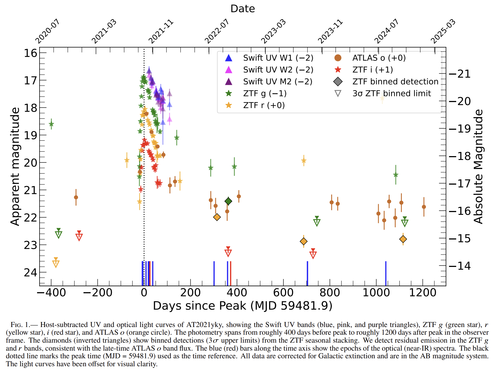

4. [Probing Variations in Earth's Ionosphere Using Pulsars](https://arxiv.org/abs/2608.06744)

    > Pulsar, Ionosphere, Rotation Measure, Total Electron Content, Observation

    研究用德国 LOFAR 对 PSR J0814+7429 进行 $32$ 天低频偏振观测，将每 $10$ 分钟的 RM 序列扣除稳定星际介质项，并结合 World Magnetic Model 反演脉冲星视线上的电离层总电子含量（TEC）。日变化 RM 幅度为 $0.5$–$1\ {\rm rad\,m^{-2}}$，所得 TEC 昼夜起伏与独立全球电离层图一致，且重现太阳驱动的中午咬蚀；个别太阳活动日的双站差异也显示其追踪短时空间天气的潜力。结果表明脉冲星能成为 GNSS 之外的定向电离层探针，多条视线的累积可补充高纬和海洋等 GNSS 稀疏区。由于分析只覆盖一条视线，并假定星际 RM 恒定和电离层为薄球壳，它不能直接替代全球电离层重建。
    
    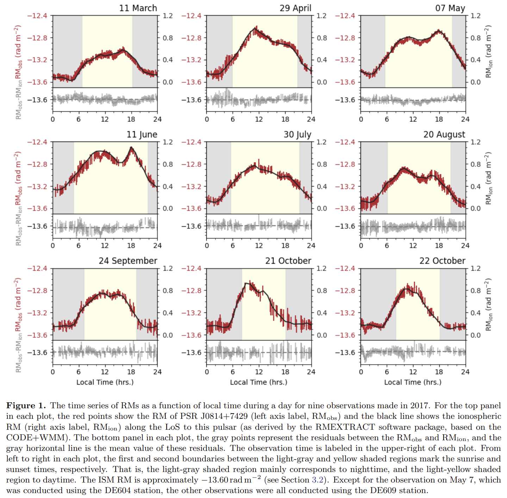

## 2026-08-11

1. [On the Physical Origins of Long Period Radio Transients](https://arxiv.org/abs/2608.08243)

    > Long Period Radio Transient, Compact Object, Binary System, Radio Emission, Theory

    长周期射电暂现源的分钟至小时周期与已发现的红矮星伴星，难以由单一中心引擎解释。研究以 Roche 极限与质量转移约束划分可行参数区，再计算白矮星和中子星的对产生、逆康普顿级联、单极感应及磁层重联功率，并把偏振、RM、光学/X 射线伴体和拍频纳入诊断流程。结论倾向于：短周期源较可能是孤立慢转中子星，长周期源更自然来自脱离的 WD/NS+RD 双星；孤立白矮星通常难以稳定点亮相干辐射。该框架是针对不同观测特征的理论归因，尚不能以任一单项诊断唯一锁定中心引擎，尤其极长周期中子星还需额外能源。

    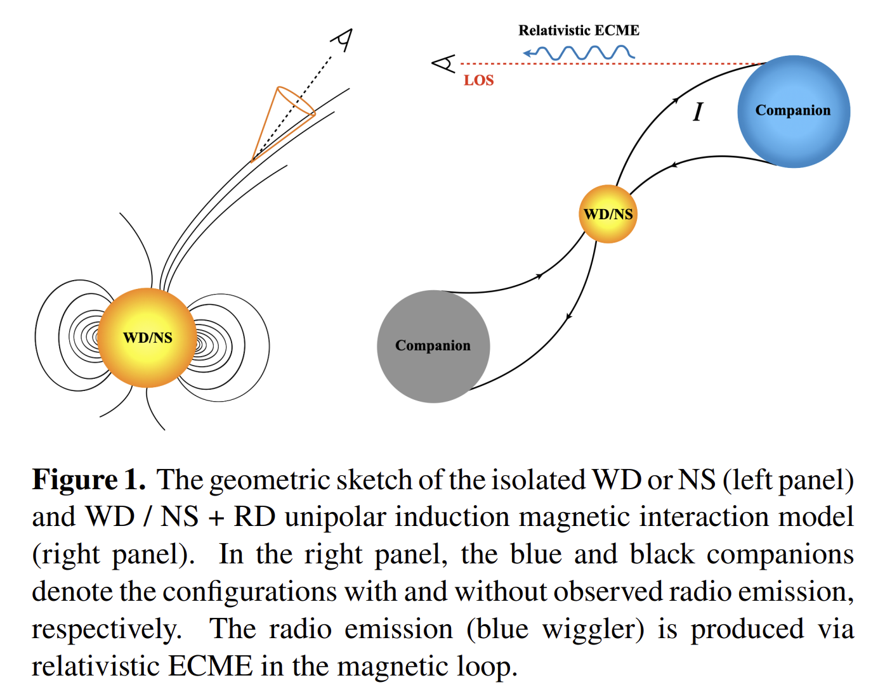

2. [Timing and statistical analysis of single-pulse search pulsar discoveries from the PALFA survey](https://arxiv.org/abs/2608.08754)

    > RRAT, Pulsar Timing, Single Pulse Search, Fast Radio Burst, Observation

    针对只能以孤立色散脉冲发现的 PALFA 源，研究重新搜索 Arecibo 与 CHIME 观测，结合单脉冲 TOA 计时和贝叶斯能量/等待时间分布拟合，厘清它们是 RRAT、普通脉冲星还是 FRB。12 个目标中 5 个获得相位连贯计时解，另 2 个测得自转周期；可测源的脉冲能量支持对数正态分布、到达等待时间与泊松过程相容，说明“单脉冲可见”并非同一种发射物理，也提示常规周期搜索会漏掉一部分间歇射电源。J0613+18 的 DM 及随访仍更符合河外 FRB，但未排除银河系未建模电子结构，故不能当作已定位 FRB。示例分析代码和部分实测脉冲轮廓见 [GitHub](https://github.com/GrahamDoskoch/PALFA-RRAT-example-code)。

3. [Locating the missing baryons in the warm-hot intergalactic medium with fast radio bursts and the Sunyaev-Zel'dovich effect](https://arxiv.org/abs/2608.09014)

    > Fast Radio Burst, Warm Hot Intergalactic Medium, Sunyaev Zel'dovich Effect, Missing Baryons, Cosmology

    为把 FRB 的自由电子柱密度与热压信息合并成 WHIM 示踪量，研究针对单独 DM 不能区分温度相、tSZ 又常被星系团主导的难题，对 CHIME/FRB Catalog 2 的 DM 场与 Planck PR4 tSZ Compton-$y$ 图做角交叉功率谱，掩蔽星系团并以 MCMC 同时拟合 WHIM 重子份额和 CHIME 定位核。基准分析的相关拒绝零假设达 $3.05\sigma$，在固定平均电子温度 $T_e=2.4\times10^6\,{\rm K}$ 下给出 $f_{\rm WHIM}=0.48$（68% 区间 $0.27$–$0.61$）；强化团簇遮罩后份额近似稳定，支持信号主要来自弥散宇宙网而非团内热气体。该比例本质上仍与气体温度、非定位 FRB 的伪红移及 tSZ 地图处理退化，因而是条件性的统计约束，不能等同于已直接完成重子普查。

    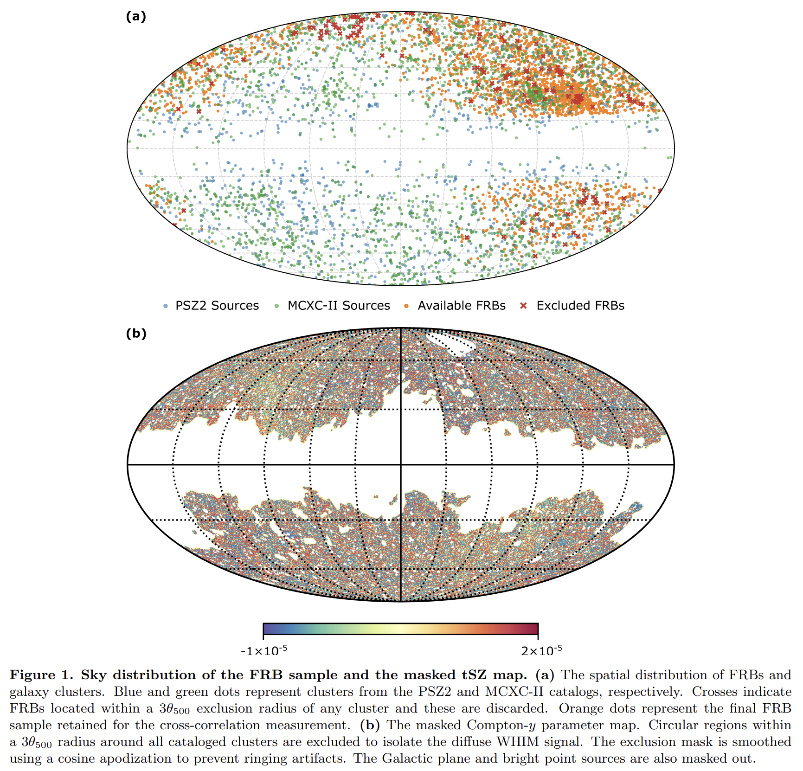

4. [Statistical inference of fast radio burst environments using galaxy number density](https://arxiv.org/abs/2608.09192)

    > Fast Radio Burst, Galaxy Environment, Large Scale Structure, CHIME, Observation

    没有足够亚角秒定位的情况下，研究以 CHIME Catalog 1 的 DM 推断 FRB 红移，在 WISE×PS1 光学/红外星系表的相应红移切片和 6 Mpc 孔径中计数，并与同场随机孔径作 KS/Monte Carlo 比较。方法允许纳入大量未定位爆发，但刻画的是数 Mpc 尺度环境而非星系内部位置。重复与非重复 FRB 的密度增量分布无显著差异（$p_{\rm KS}=0.673$），故暂不支持二者环境或起源通道不同；合并样本相对随机场则偏向低密度，中位 $p_{\rm KS}=0.0284$，暗示更偏好形成恒星的晚型或低质量宁静星系环境。这个大尺度统计不能替代宿主鉴认，且对宿主 DM 的假定敏感；所用数据可从 [CHIME/FRB Open Data](https://chime-frb-open-data.github.io/) 获取。

5. [A Machine Learning Based Search for Lunar Anomalies](https://arxiv.org/abs/2608.09350)

    > Lunar Remote Sensing, Anomaly Detection, Variational Autoencoder, Machine Learning, Tool

    面对 LRO NAC 十余年积累的亚米至数米分辨率影像，研究测试无监督 $\beta$-VAE 能否先学到“正常”月壤的潜在表示，再以重建残差给 $64\times64$ 像素块排序，从而不依赖人工类别寻找罕见地形或技术物体。模型在 Plaskett 与 Paracelsus C 两处已知异常上给出高分，并在一组阿波罗、月球与嫦娥着陆/撞击遗址中识别出多数含目标图块，显示同一异常分数可筛查岩崩、陨坑、火山坑和人造物。限制是分块尺度会偏向占据大面积的结构，小型资产的得分较低，且尚未完成全球盲搜，因而不能把高分直接解释为新技术迹象。实现代码见 [GitHub](https://github.com/lesnikow/jstars-automated-discovery)。
    
    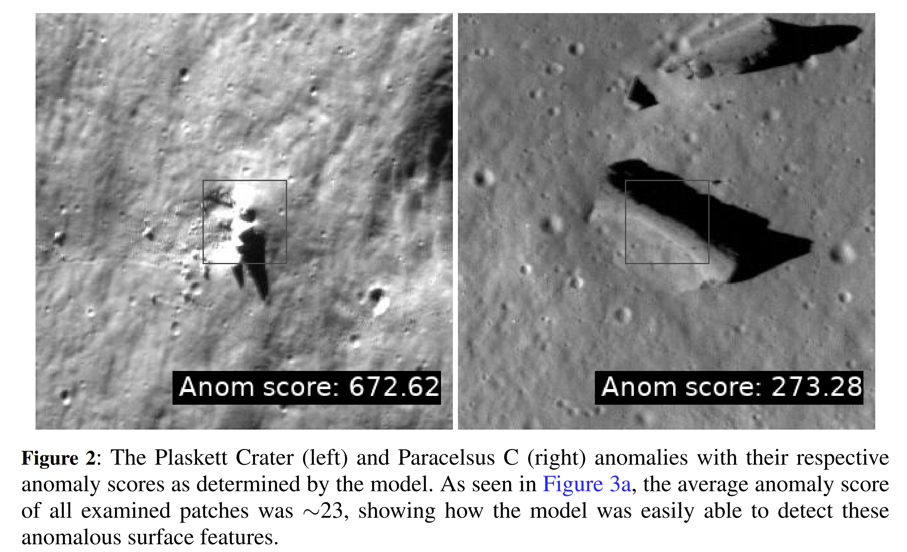

## 2026-08-12

1. [Evidence for Enhancement in the Rate of Fast Radio Bursts Toward Galaxy Clusters](https://arxiv.org/abs/2608.10358)

    > Fast Radio Burst, Galaxy Cluster, Gravitational Lensing, Population Analysis, Observation

    为检验星系团视线是否改变 FRB 探测率，研究将第二版 CHIME/FRB baseband catalogue 与 DECaLS 星系团交叉，以 $DM$ 推断红移、角距权重和 Monte Carlo 随机天区模拟筛选关联事件。得到 26 个疑似来自星系团成员或其后方的 FRB；相对无团影响的模拟，数量过剩达 $3\sigma$，相当于目录总探测数增加 $1.4\pm0.4\%$。成员星系产生的额外源和引力透镜放大的背景源均可能贡献，FRB 20211113A 是 Abell 2218 的一个值得后续验证的初步透镜候选。由于大多数源没有可靠宿主和红移，关联依赖群体模型及蒙特卡洛统计，不能据此确认单个爆发的星系团归属或透镜状态。

2. [Two new highly scattered fast radio bursts: evidence for scatter broadening by the circumsource medium](https://arxiv.org/abs/2608.10452)

    > Fast Radio Burst, Scattering, Circumsource Medium, ASKAP, Observation

    ASKAP-CRACO 调试观测发现一对高散射 FRB，并结合亚频段脉冲轮廓拟合、闪烁带宽、干涉定位和宿主积分视场光谱定位散射屏。FRB 240210D 与 240312D 在 1 GHz 标度的散射时间分别为 $34\pm6$ 和 $300\pm48\,\mathrm{ms}$；后者的银河系闪烁屏将主散射屏限制在距源约 10 pc，使宿主中心、背景星系和前景结构的解释均不成立。星形成区附近的周源介质，尤其脉冲星风星云的折射散射，最符合现有约束；长时标事件率也支持强散射与源本身相关。该模型仍需精细的视线取向，且个例量很小，尚不能把机制推广到所有高散射 FRB。

    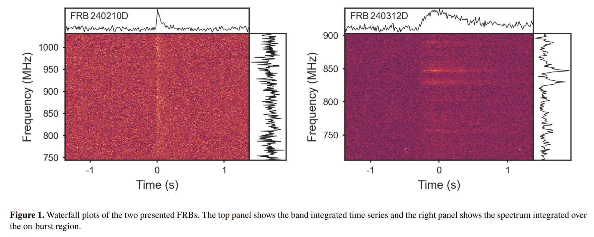

3. [Synchrotron-Regulated Relativistic Magnetohydrodynamic Turbulence: Emission, Polarization, and Faraday Rotation](https://arxiv.org/abs/2608.10748)

    > Relativistic MHD, Synchrotron Cooling, Faraday Rotation, Turbulence, Simulation

    为连接强辐射相对论等离子体的湍流动力学与可观测量，研究在 Athena++ 中进行含自洽同步辐射冷却的三维相对论 MHD 受迫湍流模拟，并由快照生成同步辐射谱、线偏振和 RM 图。能量注入与冷却在准稳态平衡，冷却诱发热不稳定性，将介质分成热而稀与冷而密两相；高频辐射由罕见的热、强磁柱主导，因而强度与偏振的时空起伏更大，线偏振可接近约 $72\%$。RM 也随湍流强烈变化，主要受平均温度调制，这与重复 FRB、脉冲星风星云和耀变体的若干定性特征相符。固定驱动、热且各向同性电子分布以及缺失电阻、热传导和非热辐射，使这些源对应仍只是定性提示。

    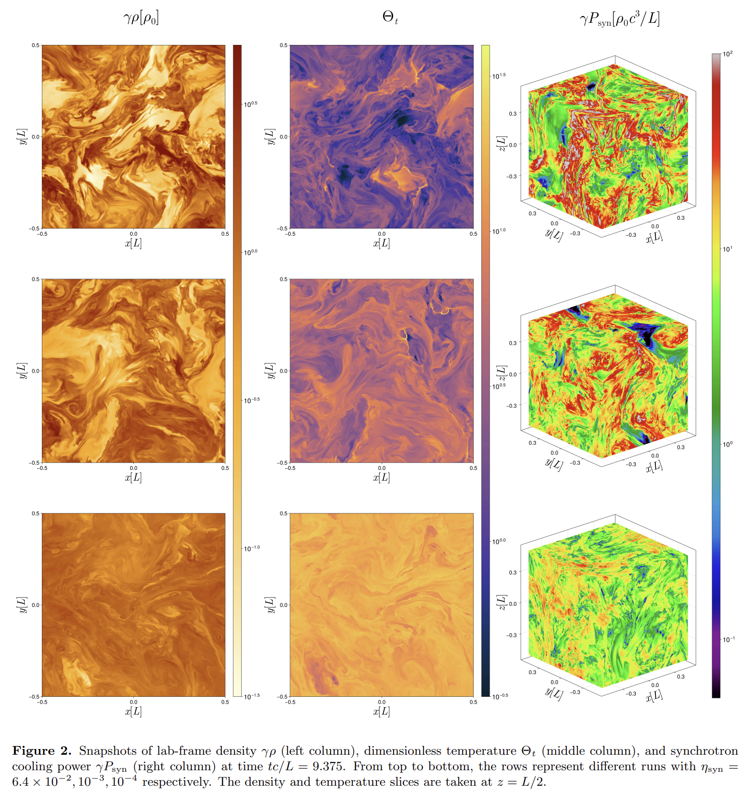

4. [The Radcliffe Wave is not alone in the Local System](https://arxiv.org/abs/2608.10884)

    > Radcliffe Wave, Open Star Cluster, Galactic Structure, Vela Ridge, Observation

    为检验本地系统中除 Radcliffe Wave 外是否也存在年轻星团描出的垂向波，研究从 Hunt–Reffert 的 Gaia DR3 星团表中选取 Vela Ridge 方向的年轻对象，按旋转坐标投影后以傅里叶分析拟合 $z(y')$，并以误差模拟估计参数不确定度。136 个候选星团给出最大振幅 $47.0\pm0.2\,\mathrm{pc}$、波长 $1.13\pm0.01\,\mathrm{kpc}$，从而首次以疏散星团确认 Vela Ridge 的周期结构。振幅与尘埃图估计相近、星团平均年龄略高于 Radcliffe Wave，支持两者可能是相近且有共同成因的空间波列。波长却随尘埃和星团示踪显著改变，且驱动机制仍未知；这种空间相关性不能证明二者必属同一物理过程。
    
    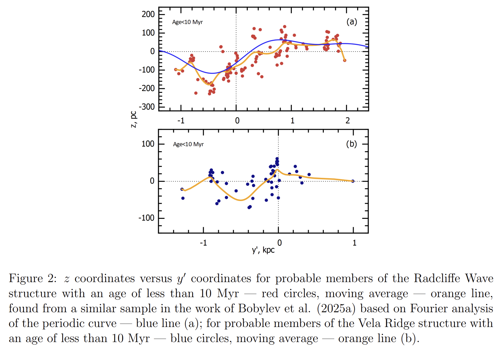

## 2026-08-13

1. [Which is the best day of the week to submit to arXiv:astro-ph?](https://arxiv.org/abs/2608.11268)

    > Bibliometrics, arXiv, Citation Analysis, Astronomy, Tool

    研究检验 arXiv 提交时间是否与天文论文后续引用有关。整合 NASA ADS、arXiv v1 时间戳和 37,173 篇 astro-ph 预印本，按纽约时区提交日及公告批次分组；样本限于主要期刊的同行评审论文，并显式处理周末无公告的排程。针对重尾引用分布，用中位数、bootstrap 区间与秩检验比较。周末提交、并汇入周一加长列表的论文在大多数期刊中位引用低 12–26%，工作日之间则没有可辨差异。结果与周一可见度被稀释相容，但也可能由周末投稿论文类型或作者构成差异造成，不能推出个人应避开周末投稿。分析管线、缓存数据和逐刊报告见 [GitHub](https://github.com/chirag003214/astroph-weekday-citations)。

    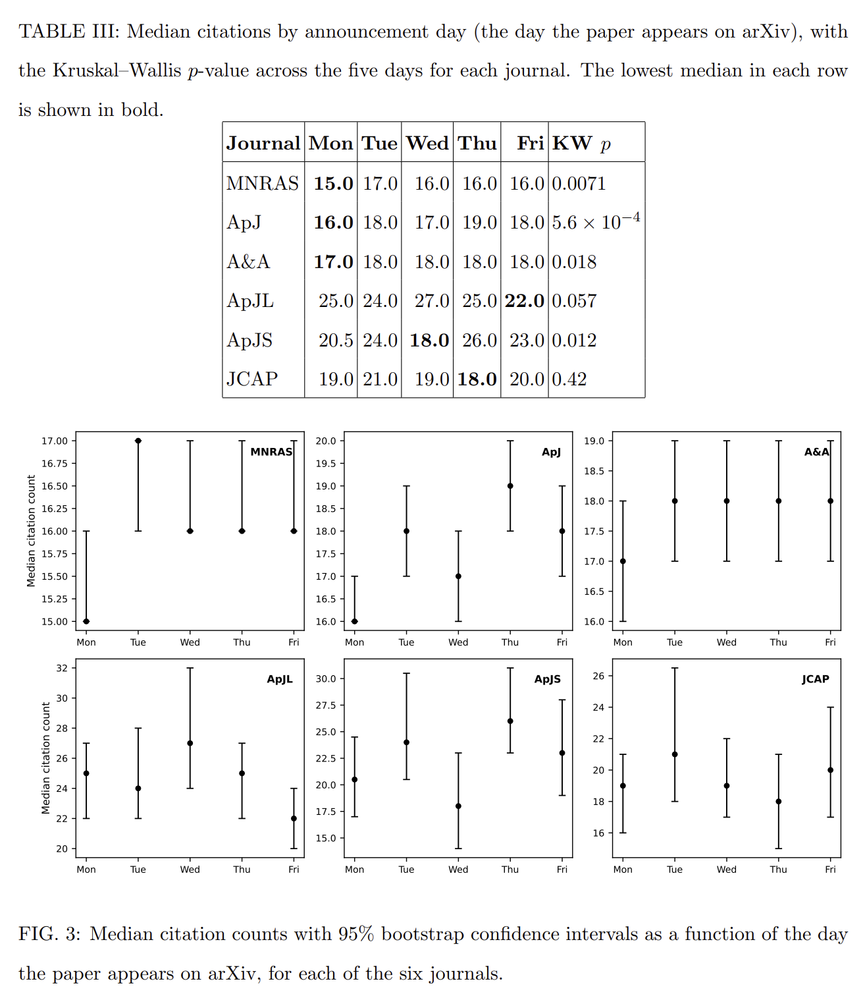

2. [A new measurement of the FRB DM-galaxy cross correlation and a first joint analysis with the kinematic SZ effect](https://arxiv.org/abs/2608.11296)

    > Fast Radio Burst, Cosmology, Baryonic Feedback, Kinematic Sunyaev Zel'dovich Effect, Observation

    为测量星系周围和大尺度中的自由电子聚集，研究将具宿主红移的 FRB 剩余 $DM$ 与 DESI Legacy Survey BGS 星系作配置/谐波两域交叉相关，并以 FLAMINGO 水动力模拟及 halo model 推断反馈，同时剔除近邻宿主配对以降低视线噪声。130 个定位 FRB 给出 $6.5\sigma$ 信号，气体无反馈地追随暗物质的情形被约 $9\sigma$ 排斥；$DM$ 随星系质量上升的趋势也在多个质量档中检出。与 kSZ 的光深比较在误差内相容，说明两者可相互补偿尺度覆盖、帮助校准光深—速度退化。当前反馈偏好仍受样本小、宿主匹配和异质 FRB 搜索的 $DM$ 选择函数限制，强反馈的物理定量解释尚属初步。

3. [Discovery of 27 new Rotating Radio Transients by MeerTRAP](https://arxiv.org/abs/2608.11968)

    > Rotating Radio Transient, Pulsar, Single Pulse Search, MeerKAT, Observation

    MeerTRAP 利用 MeerKAT 伴随单脉冲搜寻、瞬变缓冲电压成像和 Effelsberg/Murriyang 随访，扩展银河系间歇射电源样本，并以到达时刻和多历元 TOA 计时测量自转、估算脉冲流量和爆发率。新报 27 个瞬变，其中 14 个获得角秒级定位，部分得到相位连贯计时或在折叠搜寻中显现持续、普通脉冲星式周期辐射。结果说明 RRAT 的“单脉冲发现”标签包含极端零脉冲、微弱普通脉冲星与真正高度间歇源，二者边界是连续的。未发现周期辐射的来源仍需更长随访，不能仅凭当前单脉冲资料确定其内禀类别。

4. [Search for a Globular Cluster whose Passage through the Galactic Disk could Trigger the Radcliffe Wave](https://arxiv.org/abs/2608.12028)

    > Radcliffe Wave, Globular Cluster, Star Formation, Galactic Dynamics, Simulation

    为检验 Radcliffe Wave 是否源于外来撞击体穿越银盘，研究在含非轴对称扰动的银河势中反向积分球状星团和年轻疏散星团轨道，并对输入天体测量与势参数作 Monte Carlo 扰动。于该波的空间选择区找到 17 个在位置、速度和年龄上聚集的疏散星团；NGC 4372 的最近一次过盘发生在 55.5 Myr 前，约 22.2 Myr 后在相同区域出现这组星形成活动，时间尺度与触发性形成星暴相容。该时空关联把 NGC 4372 提升为一个具体候选撞击体，也给出两个较老簇与 Pal 13 的副候选。因结论依赖银河势、轨道回推与年龄估计，且其他波形成机制尚未排除，它仍是可检验的因果假说而非触发证实。

    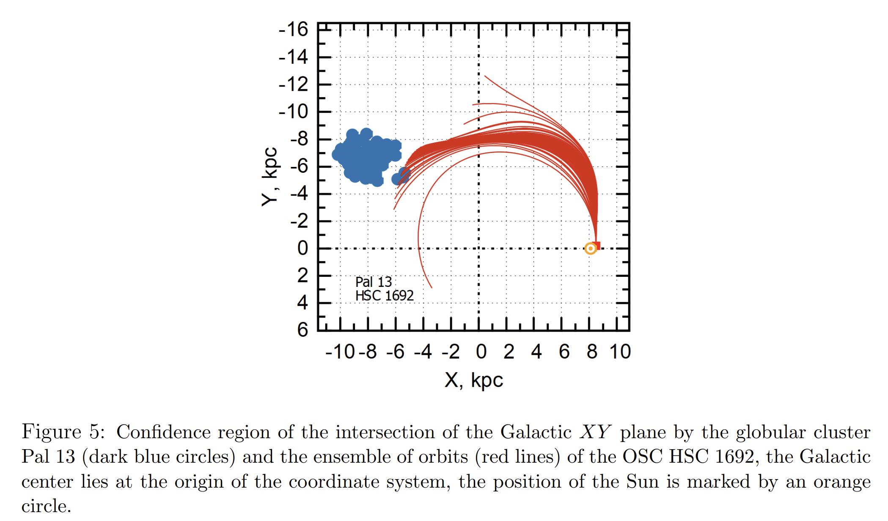

5. [The Delay Time Distribution of Quasi-Periodic Eruptions](https://arxiv.org/abs/2608.12261)

    > Quasi Periodic Eruption, Tidal Disruption Event, Post Starburst Galaxy, EMRI, Observation

    研究把 QPE 宿主的光学谱与质量、红移匹配的场星系联合拟合，采用双组分星形成史和 Bagpipes 重建最近星暴的年龄与质量份额，借此构造 QPE 相对于普通星系的延迟时间分布。高星暴质量份额宿主的速率随星暴后年龄表面上升并在约 $1\,\mathrm{Gyr}$ 附近达到峰值，且 QPE 宿主较 TDE 宿主和对照样本更偏好强星暴，支持强星暴可能提高与 EMRI 相关的形成效率。这个年龄峰在统计上仍与平坦分布相容，且可用光谱的宿主样本仅 10 个、星暴年龄受 SFH 参数化影响；目前只能视为对 QPE 形成通道的提示，不能选择性确认 EMRI 参与的盘相互作用模型。
    
    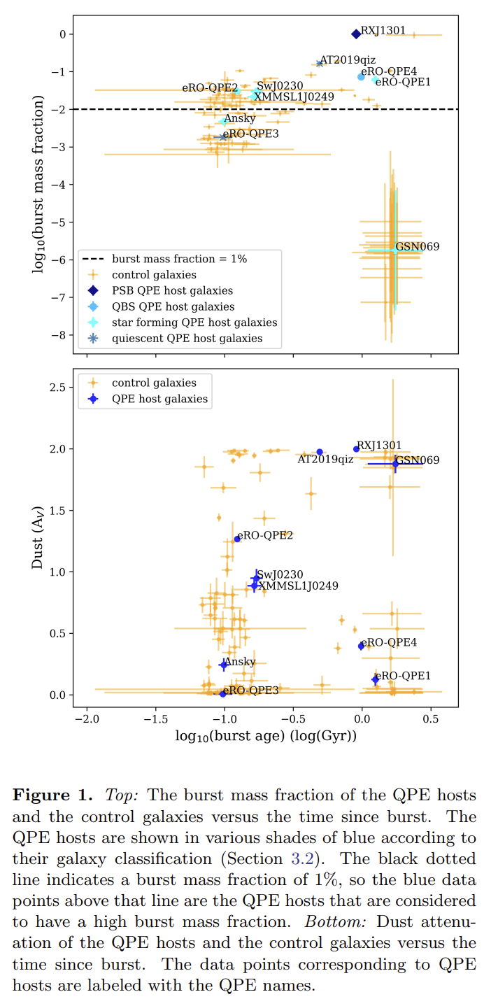

## 2026-08-14

1. [SNIFFLES I: Intended Emission, Unwanted Emission, and Unintended Radiation from Low-Earth Orbiting Satellites Impacting Radio Astronomy from 1-26 GHz](https://arxiv.org/abs/2608.12999)

    > Radio Frequency Interference, Satellite Constellation, Radio Astronomy, Spectrum Monitoring, Observation

    为量化非地球同步卫星星座对射电天文的全类干扰，SNIFFLES 以 Mopra 逐星跟踪多种卫星星座，并由 ATCA/BIGCAT 定标复测；通过多普勒漂移与预测星历的一致性确认辐射来源。大样本观测记录 2,345 次辐射事件、分布于数百个频点，显示预定发射、带外发射和卫星电子学非预期辐射均已进入射电观测频段。2700 MHz 的非预期辐射在相关 Starlink V2-Mini 版本的 76.9% 观测中出现，跟进测量表明其可远超接收机饱和水平。因卫星软硬件和运营状态持续变化，统计量按版本与时段累计，不能视为任一星座当前或单颗卫星的固定发射谱。

    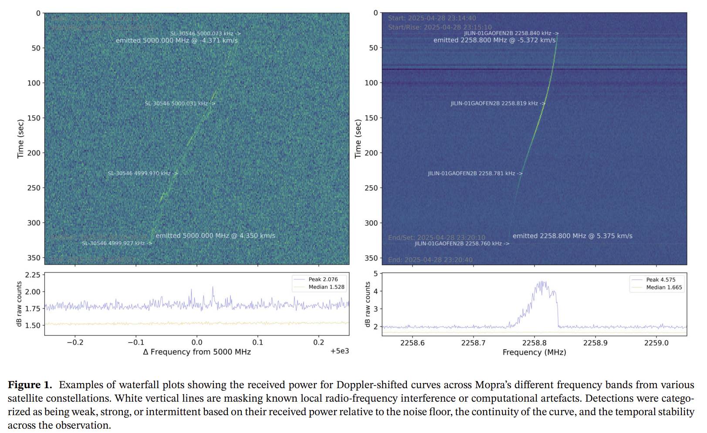

2. [Radio Monitoring of Classical Novae using the ASKAP Variable and Slow Transients Survey](https://arxiv.org/abs/2608.13330)

    > Classical Nova, ASKAP, Radio Survey, Synchrotron Emission, Shock Acceleration

    为从统一巡天中识别经典新星的低频射电机制，研究在 ASKAP VAST 的 887.5 MHz、双周监测资料中交叉光学爆发目录，找到 3 个具有完整光变曲线的源，并以热自由—自由辐射、标准同步辐射和含断裂幂律密度结构的同步辐射模型作 MCMC 拟合。三者均更支持早期非热同步辐射主导，说明快速喷出物与非均匀周双星物质的内部激波可有效加速粒子；其全部伴随伽马射线探测，也使二者相关性值得追踪。断裂幂律模型虽优于其他模型，但没有一个模型对所有源达到形式上可接受的拟合，且单一频率和距离、几何退化使喷出质量、能量等参数不能作精确物理测量。
    
    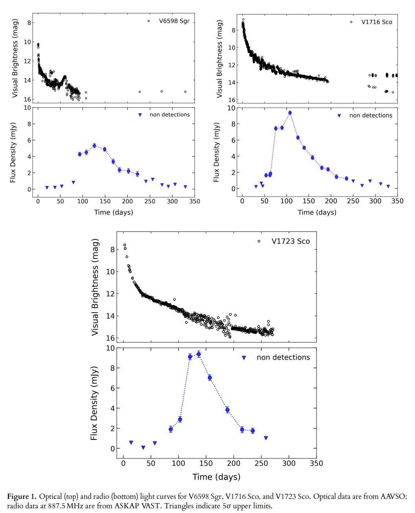

## 2026-08-17

