## 2026-08-03

1. [Understanding constraints on primordial mass black holes made of dark matter using fast radio bursts](https://arxiv.org/abs/2607.28704)

    > Fast Radio Burst, Primordial Black Hole, Modified Gravity, Gravitational Lensing, Theory

    研究把 636 个 CHIME FRB 的色散量换算为源红移，在 de Sitter–Schwarzschild 型标量—张量引力度规下计算原初黑洞透镜光学深度，并利用尚无确认透镜事件这一事实给出暗物质中原初黑洞比例的泊松上限。修正引力参数 $\kappa$ 会改变双像时间延迟和可探测区间，使所得上限明显依赖引力模型。其效应类似光路上的等离子体散射屏，提示透镜解释可能与传播效应退化。该会议短文的红移依赖 $DM$ 分解，且未给出模型无关的单一数值界限，因此不能作为普适的原初黑洞丰度约束。

2. [Deep Learning-Based Classification and Analysis of Pulsar Candidates in Fermi-LAT Unassociated Sources](https://arxiv.org/abs/2607.28723)

    > Pulsar Candidate, Fermi LAT, Deep Learning, Gamma Ray, Observation

    TabularResCNN 将 4FGL-DR4 的多能段谱形、变异性和缺失值掩码按能量顺序送入一维残差 CNN，先区分 AGN 与脉冲星，再区分青年与毫秒脉冲星；训练时不使用天区坐标，并以代价敏感阈值优先提高射电跟进纯度。首级验证准确率约 97%，最终筛出 202 个高置信脉冲星候选，Grad-CAM 显示分类主要依赖物理上合理的能段和变异特征。青年/毫秒脉冲星二级分类准确率仅 81.4%。这些对象仍是模型候选，独立射电确认样本很少，因此该清单适合安排跟进优先级，不能直接当作新增脉冲星人口。

3. [Visual analytics for cosmological simulation results](https://arxiv.org/abs/2607.29426)

    > Cosmological Simulation, Visual Analytics, WebGL, Tool

    ARGOS 是面向宇宙学模拟的开源浏览器端可视分析工具，以 WebGL/GPU 渲染 HDF5 或表格数据，无需安装或服务端计算。它用可复用模板连接三维空间、速度、散点图和直方图，支持联动筛选以及从星系目录下钻到单个对象；示例中据此定位了 TNG50–SKIRT 合成图像的尘埃分配伪影。[源码](https://github.com/pvaut/skirt-argos)已按 MIT 许可开放。代价是数据全部进入浏览器内存，单个资产实际约限于 1–2 GB、约 $10^7$ 个粒子，原始大规模模拟仍需外部降采样，且论文展示的是用例而非性能基准。
    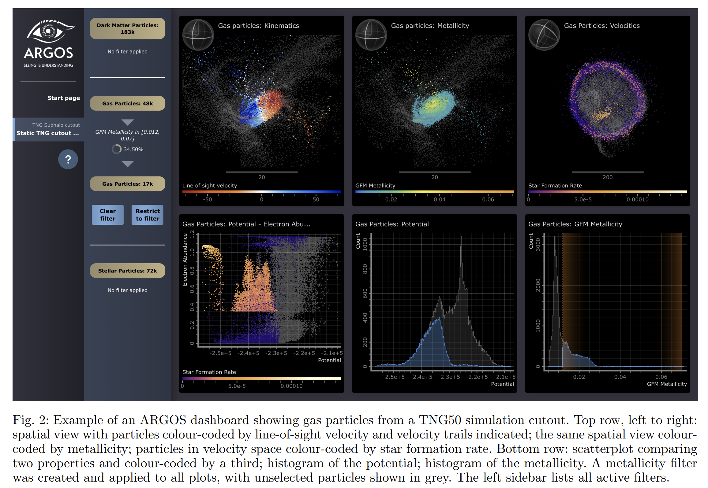

## 2026-08-04

1. [Evidence for a bursty $γ$-ray QPO in the neutrino-associated FSRQ PKS 1424$-$418 using Fast Template Periodograms and Machine Learning](https://arxiv.org/abs/2608.00664)

    > Blazar, Gamma Ray, QPO, Machine Learning, Observation

    研究在 100 条七日分箱的 Fermi-LAT 耀变体光变曲线上，先用奇异谱分析去趋势，再以正弦、窄脉冲和经验非对称模板进行快速模板周期图搜索，并用随机森林检验候选的跨周期结构稳定性。形态感知模板能找回被正弦假设产生的谱泄漏压低的爆发型周期信号，但机器学习也排除了多数缺乏稳定相位相干性的假阳性。最终 PKS 1424−418 保留一个 4.8 年 QPO 候选。计入百源搜索的试验因子后显著性仅约 $2.4\sigma$，因此仍需更长时间基线或多波段独立确认。

    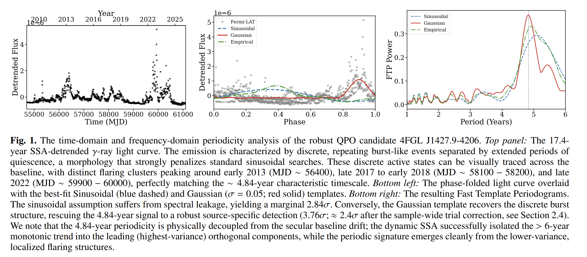

2. [Identification and Study of Irregular Radio Sources with SKA Continuum Surveys](https://arxiv.org/abs/2608.01054)

    > Radio Galaxy, SKA, Radio Morphology, Machine Learning, Review

    这篇综述聚焦弯尾和翼状等非规则射电星系，讨论 SKA-Low 对低表面亮度、陡谱老化等离子体的探测能力，以及 SKA-Mid 对喷流、瓣和翼结构的分辨与偏振测量。作者建议用机器学习分割和形态参数筛选候选体，再结合光学/红外宿主匹配、环境目录和人工复核，把形态连接到喷流—环境作用、AGN 活动周期及星系团动力学。文中没有给出可直接采用的 SKA 产额，只将现有巡天作为经验标尺。现有训练集难以覆盖 SKA 将看到的更暗、更高红移形态，分类器仍需用 SKA 类模拟和早期数据重新校准。

    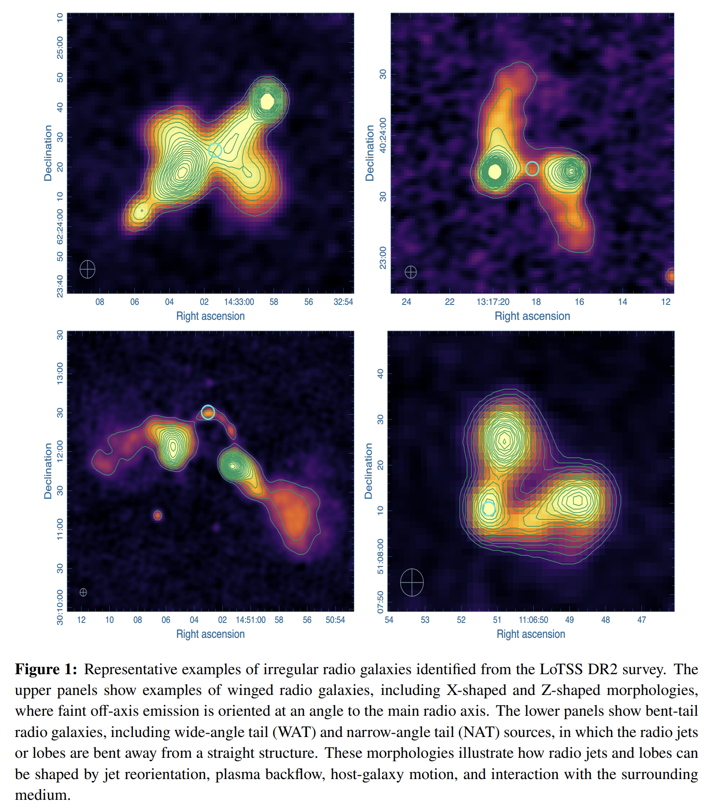

3. [Propagation Diagnostics of Supernova Remnant Environments around Young Repeating FRBs. I. Hydrodynamic Evolution of the Source-Local Dispersion Measure](https://arxiv.org/abs/2608.01342)

    > Fast Radio Burst, Supernova Remnant, Dispersion Measure, Hydrodynamics, Simulation

    二维轴对称流体模拟追踪年轻中子星各向异性风与膨胀超新星抛射物的相互作用，并用被动示踪量区分风与非风物质对源区 $DM$ 的贡献。强极向风虽挖出低密度空腔，电子柱密度仍主要来自抛射物和扫积壳；角平均超额 $DM$ 在早期近似按 $t^{-2}$ 下降，所有参数模型均保持下降趋势。对 FRB 20190520B，基准模型约在 20 年时同时得到相近下降率和约 $1.8\times10^2\ {\rm pc\,cm^{-3}}$ 的超额 $DM$。定量年龄和归一化仍依赖简化的抛射物、环境与电离设定，且模型未含磁场、冷却和三维结构，不能视为唯一环境拟合。

    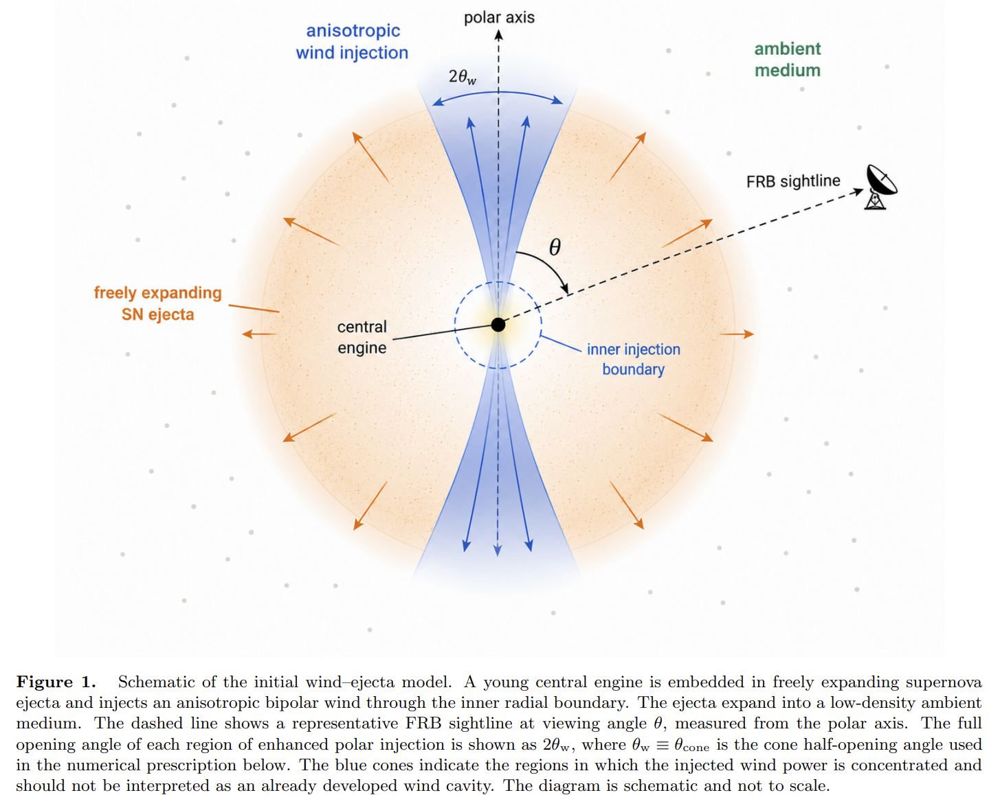

4. [Spectral decoherence without depolarization in curvature radiation](https://arxiv.org/abs/2608.01416)

    > Fast Radio Burst, Curvature Radiation, Polarization, Spectral Coherence, Theory

    研究用相干矩阵和辐射相位渐近展开分析延展超相对论电荷团的曲率辐射，比较频谱相干与偏振相干随辐射区尺度的变化。传播时延造成的相位起伏会先破坏频谱相干，而相对论束射锥内的局域偏振方向仍近似一致，因此可形成频谱已碎裂但线偏振仍很高的中间区；该区随频率和洛伦兹因子升高而扩大。这为同时具有窄带或斑块频谱和高偏振的 FRB 提供了内禀解释。推导采用一维轨迹、均匀净电荷并忽略等离子体传播及复杂磁场结构，目前只是定性机制，尚非对具体 FRB 的观测拟合。

5. [The location and propagation of fine structures in type II solar radio bursts](https://arxiv.org/abs/2608.01923)

    > Type II Radio Burst, Solar Flare, Coronal Shock, Radio Imaging, Observation

    研究用 Nançay 射电日像仪的三频成像与 SDO/AIA 极紫外图像，定位一次无日冕物质抛射、但伴随 M1.1 级耀斑和日冕波的 II 型射电暴细结构。不同谱带和鲱鱼骨爆发来自耀斑周围多个区域，射电质心沿弯曲、折返或近静止的不同路径运动，并随日冕波扩张总体向外迁移。这支持扩展激波在不同位置间歇加速电子，而非单一固定辐射源，也表明 CME 并非产生 II 型暴的必要条件。NRH 频率采样稀疏且缺少多视点极紫外观测，单个细结构的跨频追踪和激波三维几何仍不确定。

    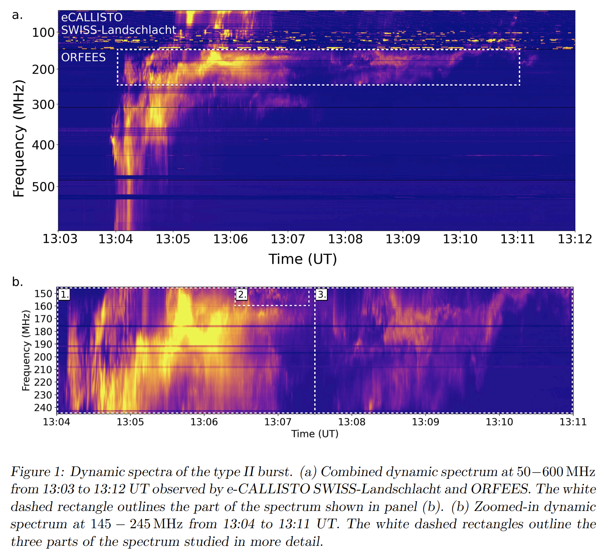

6. [Searching for core-collapse supernovae in binaries with ZTF](https://arxiv.org/abs/2608.01994)

    > Core Collapse Supernova, Binary Interaction, ZTF, Time Domain, Simulation

    研究为核坍缩超新星光变注入双星吸积造成的再增亮和周期振荡，用样条扣除主体爆发后再以 Lomb–Scargle 周期图搜索，评估 ZTF 类巡天的可检出性。模拟显示，覆盖数月的规则观测可找回约一半信号，而常见的一两个月基线会使回收率骤降，说明现有样本可能漏掉大量双星相互作用。在 212 个较亮且采样较好的 ZTF 超新星中，流程只找到两个值得跟进的周期候选。它们尚非双星确认；实际数据的长间隔会制造周期图假峰，故结果主要用于设计触发和后随观测，不能据此估计真实双星比例。

    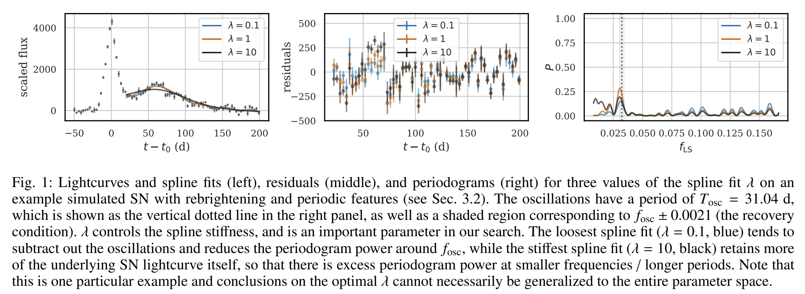

9. [Foundation Models for Astrophysics](https://arxiv.org/abs/2608.02573)

    > Foundation Model, Representation Learning, Astronomy, Machine Learning, Review

    这篇综述把基础模型的判据限定为可迁移表示：模型必须在任务、仪器或天体族群改变后，仍能用很少甚至没有新标签完成推断；Transformer、自监督预训练和规模本身都不足以获得这一名称。文章梳理光谱、图像、时域、多模态和物理模拟中的预训练、适配与跨模态方案，并建议用整台仪器、完整族群或信噪比区间留出测试，而非随机划分。核心判断是，天文学现有工作多数只证明域内性能，真正跨仪器、跨任务的迁移证据仍很少。模拟—观测域差、缺乏物理化 token、重建损失忽视微弱诊断特征等问题意味着继续放大模型未必解决迁移，直接监督仍是标签充足场景必须击败的基线。
    
    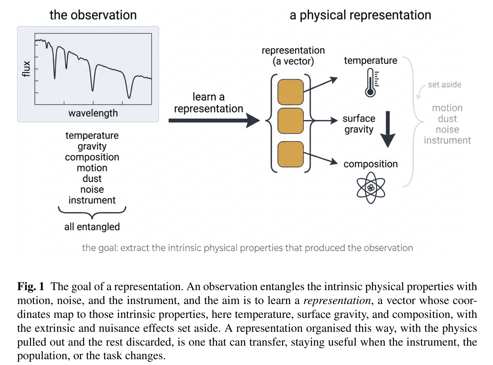

## 2026-08-05

1. [The One-Loop Power Spectrum of Fast Radio Burst Dispersion Measures](https://arxiv.org/abs/2608.03235)

    > Fast Radio Burst, Dispersion Measure, Large Scale Structure, Effective Field Theory, Simulation

    研究为 FRB 色散量构建自由电子自功率谱 $P_{ee}$ 与电子—星系交叉谱 $P_{eg}$ 的单圈有效场论模型，使其可按大尺度结构巡天的方式用于低红移重子和星系反馈约束。模型在 FLAMINGO 流体模拟中联合拟合电子、电子—星系及星系谱，并在 DESI 类样本上描述到 $k\simeq0.2\,h\,{\rm Mpc}^{-1}$。电子线性偏置约为 0.92，且对不同反馈方案稳定，支持自由电子近乎无偏地追踪物质。结论仍来自模拟和巡天预报，实际收益强烈依赖 FRB 面密度、红移定位及宿主色散散布，尚未由真实聚类测量验证。

2. [A study on the contribution of the interplanetary medium in radio occultation experiments](https://arxiv.org/abs/2608.03435)

    > Interplanetary Medium, Radio Occultation, Doppler Tracking, Plasma Turbulence, Observation

    研究汇集 Chandrayaan-2/3、Venus Express 和 Akatsuki 的五组 S/X 波段射电链路，利用多普勒残差及功率谱密度分离行星际介质、月球附近等离子体和日冕造成的频率扰动。远离日月的行星际视线仅呈 mHz 级弱波动，月掩和日掩数据则显示更强且依赖环境的湍流谱；双程相干 S 波段对微弱等离子体扰动尤其敏感。结果给出深空跟踪中行星际多普勒噪声的经验基线，也说明不同频率和链路构型不可直接比较。样本只是少量、偏安静条件下的个案，几何和太阳活动覆盖不足，谱斜率尚不能作为普适的湍流分类或空间天气诊断。

3. [First fast radio burst search campaign at the Argentine Institute of Radio Astronomy](https://arxiv.org/abs/2608.03914)

    > Fast Radio Burst, Radio Transient, Single Pulse Search, Machine Learning, Observation

    阿根廷射电天文研究所用一面 IAR 天线在南天邻近超星系团方向开展首轮 FRB 搜索，以 PRESTO 检索色散脉冲、FETCH 分类候选，并用已知 Parkes 爆发和注入信号验证流程。212 h 有效观测中得到候选 FRB 20251018，其 $DM=243\pm15\ {\rm pc\,cm^{-3}}$、信噪比为 8.2，方向位于 Phoenix 超星系团的 A2870 星系团视场。信号通过频段裁剪检验，但后续未见重复爆发，也没有宿主定位。由于仅由单天线接收且信号接近阈值，局地干扰或仪器伪迹尚未被独立排除，因此应视为候选，而非南美首例已确认 FRB。

## 2026-08-06

1. [Predicting the Kinematics of the Cold Circumgalactic Medium from its Morphology using Convolutional Neural Networks](https://arxiv.org/abs/2608.04087)

    > Circumgalactic Medium, Kinematics, H Alpha, Convolutional Neural Network, Simulation

    研究尝试仅从冷环星系介质的 Hα 发射形态，恢复传统观测无法直接测得的天球面速度场。基于 TNG50 中 182 个银河系/仙女座类似星系生成带前向噪声的发射图和速度真值，以 UNet 逐像素预测二维速度；模型能识别大尺度规则流入与旋转，典型 RMS 误差为 $0.3$–$0.5\,v_{\rm vir}$，小云团和热外流表现较差。结果说明形态确实包含运动学信息，但映射并非一一对应。训练与测试均来自同一套模拟，而真实 CGM 小尺度形态尚无观测约束且不同模拟差异显著，因此现阶段只能视为概念验证。

    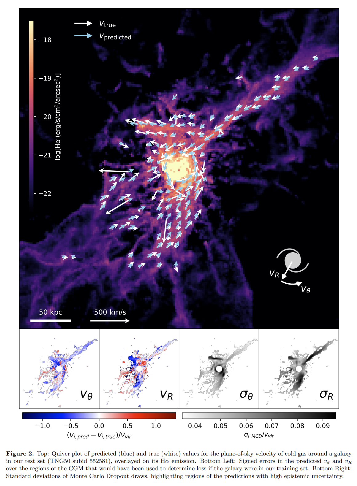

2. [Population synthesis and detection prospects for Galactic long-period transients with LISA](https://arxiv.org/abs/2608.04628)

    > Long Period Transient, White Dwarf Binary, LISA, Population Synthesis, Simulation

    研究把部分长周期射电暂现源假设为脉冲周期锁定轨道周期的白矮星紧致双星，结合已知样本和电磁演化模型生成两组银河系种群，再注入四年 LISA 数据流评估可分辨率与参数恢复。两种极端周期分布给出约 0.05%–6% 的探测比例；被检出系统的引力波频率和天空位置通常足以反向指导射电搜索。LISA 因而可直接检验其双星起源，并用轨道演化区分引力波损失与单极感应耗散。预测依赖多数源均为相位锁定双星以及总体数量和周期分布可外推的假设；若实际种群混有中子星或自转调制亚类，探测数会大幅变化。

    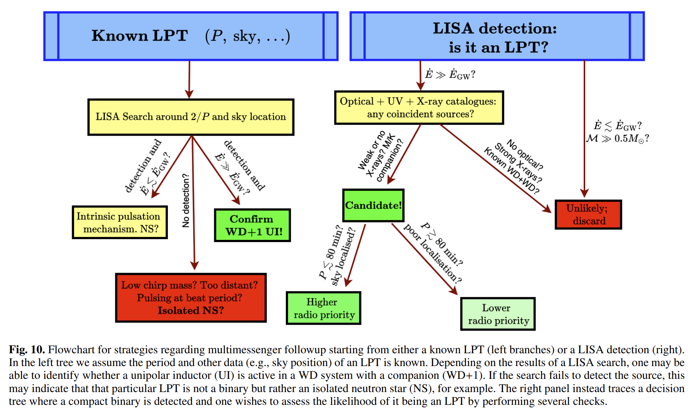

3. [MarsCast: Transfer Learning of AI Weather Foundation Models to Planetary Atmospheres](https://arxiv.org/abs/2608.05054)

    > Mars Atmosphere, Weather Forecasting, Foundation Model, Transfer Learning, Tool

    研究将只在地球 ERA5 上预训练的 GraphCast 迁移到火星，先测试零样本预报，再用 Mars Climate Database 的温度、风场和太阳辐射强迫微调，得到 MarsCast。零样本只能延续初始空间形态并迅速退化到气候平均；微调后可恢复昼夜与季节变化，早期温度误差多在 $\pm2$ K 内，并能自回归生成十天预报。模型与检查点公开于 [GraphCastMars](https://github.com/nasa-nccs-hpda/GraphCastMars)。但训练和验证目标均来自 MCD 气候模型而非独立实测，且尚未包含尘埃和真实水循环，因此目前更接近快速 MCD 代理模型，不能当作已验证的火星业务天气预报。
    
    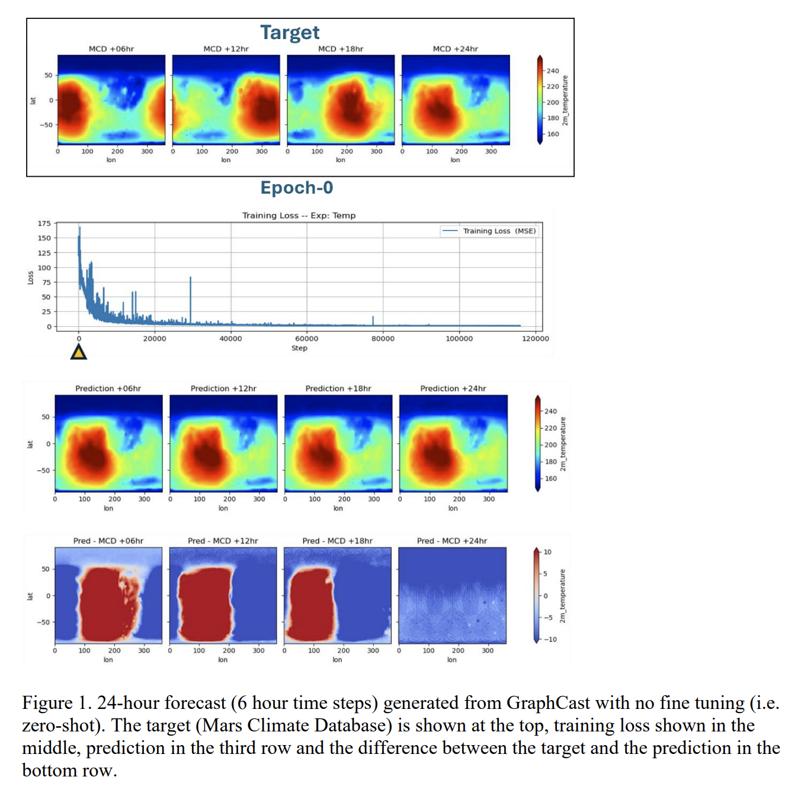

## 2026-08-07

1. [MARS: A Lightweight Morphology-Aware RFI Segmentation Network for Mask-Guided Mitigation in Radio Astronomy](https://arxiv.org/abs/2608.05546)

    > Radio Frequency Interference, Radio Astronomy, Deep Learning, GPU, Tool

    MARS 面向无法先完整落盘再清除干扰的高速射电滤波器组数据，把局域、沿时间延展和沿频率延展的 RFI 形态先验嵌入轻量全分辨率 U-Net，并将分块、掩膜替换和重标定保留在 GPU；训练损失额外惩罚把色散脉冲误标为 RFI。合成测试中，RFI 掩膜 $F_1=0.978$，清洁斑块中注入色散信号的流量保留率为 $97.6\%$；清洗后的数据在 PRESTO 搜索中可恢复与 filtool 接近的已知脉冲星候选，GH200 的纯计算速度比最快的多线程 filtool 高 $6.2$–$7.0$ 倍。[源码](https://github.com/Haalandspring/MARS)已公开。验证只含两次 GMRT 观测且主要依托可控注入，低 $DM$、高信噪比脉冲仍最容易被过度掩膜，故不能直接外推到其他望远镜或复杂干扰环境。

2. [Exploration of Exoplanet Atmospheres with the James Webb Space Telescope](https://arxiv.org/abs/2608.05885)

    > Exoplanet Atmosphere, JWST, Direct Imaging, Transit Spectroscopy, Review

    这篇综述汇集 JWST 前四个观测周期的直接成像与凌日观测，比较日冕仪、透射与发射光谱、相位曲线和食映射如何约束气态巨行星、次海王星和岩质行星的大气。近至中红外的稳定观测把直接成像的分子光谱与凌日行星的丰度和云层诊断置于同一参数空间：早期资料已确认 WASP-39 b 的 $\mathrm{CO_2}$ 和 $\mathrm{SO_2}$，并使 $\mathrm{CH_4}$ 的多波段可靠识别成为可能。若后续分配维持，任务期约有 $10^4$ 小时会用于大气表征，足以建成跨行星类型的人口统计档案；文章因此主张协调选择目标和全波段配置，追踪组成与形成、迁移历史的关系。现有样本在质量—温度和波段覆盖上仍不均匀，许多次海王星的谱近乎无特征，且 JWST 不太可能单独确认生物标志，故这是一份规划基线而非已完成的大气普查。
    
    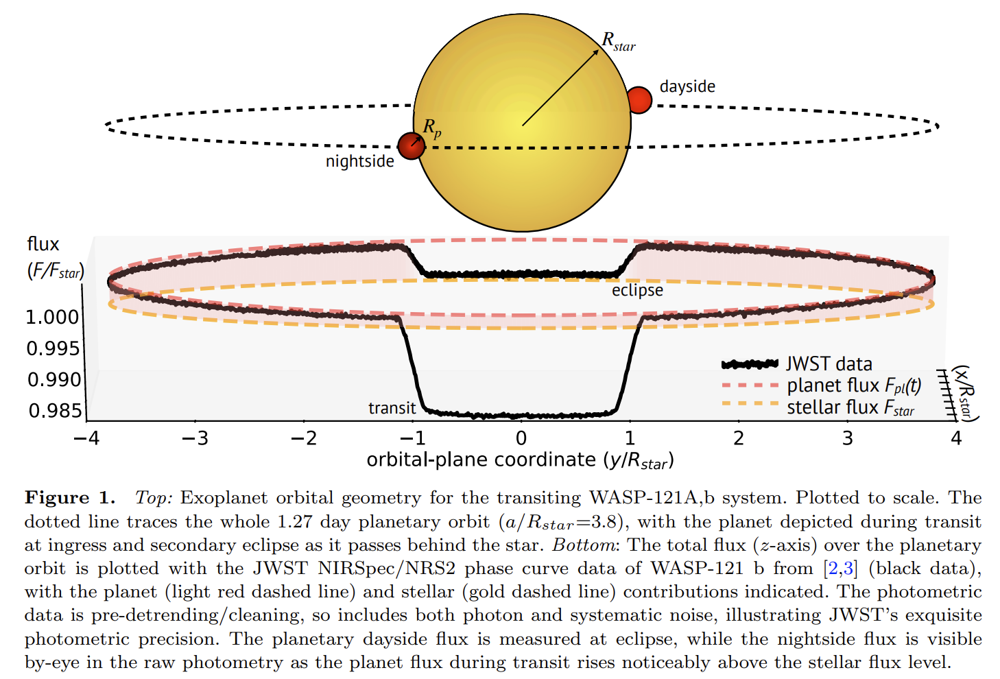

## 2026-08-10

