## 2026-10-01

1. [Learning Gaia: A Generative Model Trained on the Gaia Data Release 3 Source Catalog](https://arxiv.org/abs/2609.38326)

    > Gaia, Deep Learning

    研究以 Gaia DR3 中约 5.79 亿个源的位置、测光和天体测量参数训练条件流匹配模型，通过随机遮蔽输入学习在不同信息组合下生成模拟源或补全缺失量。模型能够重现银盘和大小麦哲伦云的大尺度分布，测光补全尤其有效，径向速度预测也利用了天空位置与运动信息。对半人马座 ω 等小而独特的子群，模型仍难以恢复其狭窄运动分布。训练目标保留星表测量误差和选择效应；具有径向速度测量的源仅占约 2%，向其余源外推时存在样本分布差异。该工作为 Gaia 数据生成模型提供了可扩展的初步方案。

    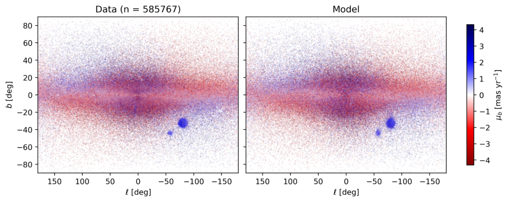

2. [VLBI Astrometric Procedure and Performance with CHIME/FRB Outriggers](https://arxiv.org/abs/2609.38344)

    > Fast Radio Burst, Localization, VLBI

    研究建立 CHIME/FRB 外站阵列在 400–800 MHz 的快速射电暴定位流程，将多校准源联合拟合、电离层先验和迭代相关处理纳入统一分析，并处理共享目标信号带来的误差相关性。超过千次连续谱校准源与脉冲星测试定位验证了误差区间的覆盖率。明亮宽带信号的二维定位精度可达约 $10\times30$ 毫角秒，弱窄带信号的误差则明显增大。电离层色散与几何时延的简并是后一情形的重要限制，更高精度还受中性大气和校准源结构影响。结果支持对单次爆发开展宿主内部环境定位，具体精度取决于信噪比和有效带宽。

    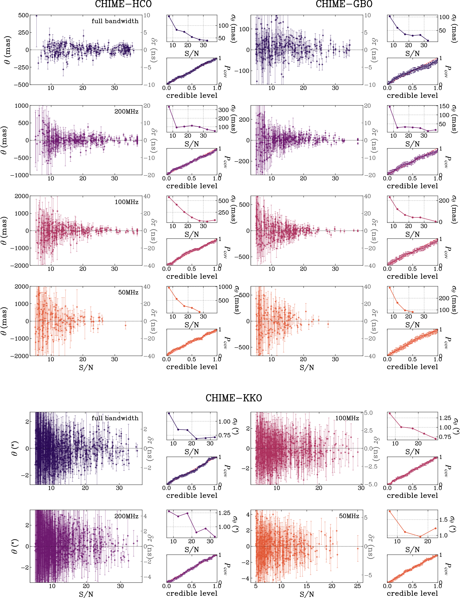

3. [PTED: A multi-dimensional two-sample test for scientific inference and generative machine learning](https://arxiv.org/abs/2609.38388)

    > Statistics, Software, Machine Learning

    PTED 将能量距离与置换检验结合，用于判断两组多维样本是否来自同一分布，并提供后验覆盖率和分布包含关系的检验接口。在样本满足独立性及零假设下可交换性的条件下，基础检验控制假阳性率；固定数量的参照点可使距离计算随样本量线性增长。高斯、双月牙、MNIST 和 CIFAR-10 测试显示其对多种偏差保持较高灵敏度，表现与常用 MMD 接近。双尾设置能够识别对训练样本的过度复制，MMD 也可采用这一设置。高维局部偏差和稀少离群点仍可能被漏检，检验通过只表示现有样本证据有限。[Python 软件包](https://github.com/ConnorStoneAstro/pted)已公开。

    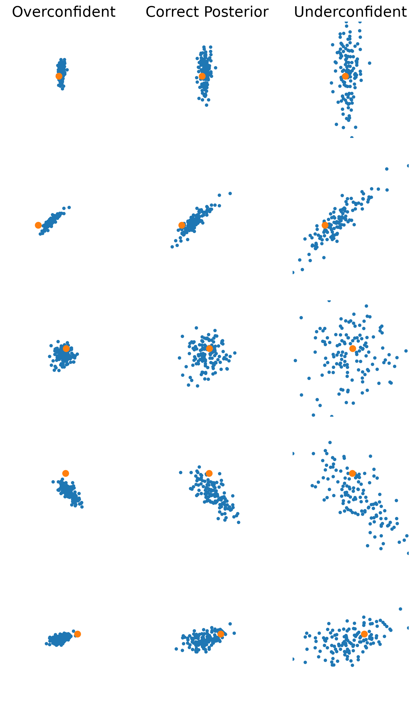

4. [The AI crisis for teaching: "Train your own neural network!"](https://arxiv.org/abs/2609.39433)

    > Astronomy, Education, LLM

    这篇观点文章结合天体物理教学经验，讨论学生直接采用大语言模型答案对知识理解、独立推理和作业评价的影响。作者强调，学习需要学生亲自经历计算、试错和判断，“训练自己的神经网络”指向这一思维训练过程。AI 可支持检索、反馈与辅导，其有效使用依赖学生逐步建立核查答案的能力。文章建议重新分配作业与考试权重，探索课堂无设备测验、受控终端和口试，并将部分助教时间投入直接交流。这些安排需要兼顾资源、公平性和考试压力；论证主要来自教学观察与案例，所提改革的实际效果仍需系统评估。

## 2026-10-02

1. [The star formation history of Orion is structured and episodic](https://arxiv.org/abs/2610.00481)

    > Stellar, Star Formation, Gaia

    研究利用 Gaia DR3 识别的 47 个共空间、共运动群体及统一测定的年龄，重建猎户座恒星形成历史。年龄分布出现多个间隔约 500 万年的增强期，较近两次对成员重采样和年龄拟合变化较稳定，较老峰的可靠性仍有限。同龄群体在空间上显著聚集，并形成多条具有局部年龄梯度的候选星团链，支持顺序形成与恒星反馈参与的图景。整体多峰性的统计证据较弱，恒星加权分布的单峰性检验得到 $p=0.064$；嵌入年轻星的遗漏和年龄模型系统误差也影响解释。这一时间间隔与天蝎—半人马区域相近，其物理起因仍待确认。

    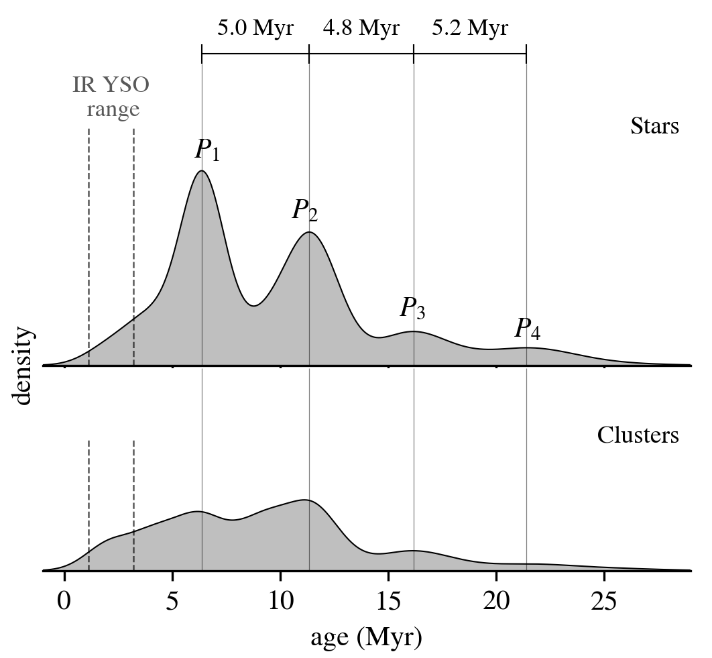

2. [Towards Retrieval Augmented Generation in High-Energy and Astroparticle Physics](https://arxiv.org/abs/2610.00891)

    > Astronomy, LLM, Software

    研究构建面向高能物理与高能天体物理文献的检索增强生成流程，将 Specter2 语义检索、BM25 关键词匹配、排序融合和交叉编码器重排结合，再由 Gemma4 筛选文献并生成带引用的短报告。合成问题基准显示，混合检索与重排显著提高来源论文的召回率，天体物理问题的前十结果召回率约为 87%–95%，宽泛探索性问题仍较难处理。相关性筛选对候选顺序敏感，多次打乱顺序后取并集可减轻这一影响。报告依据标题和摘要生成，质量验证集中于少数专家核验示例；这些结果支持文献初步导航，报告的全面性和论断准确性仍需进一步检查。

    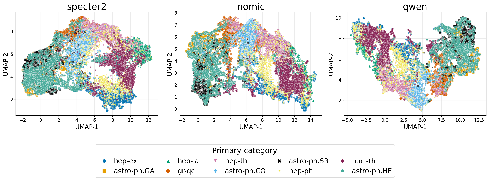

3. [A comprehensive simulation framework for multi-modal kilonova observations from all-sky surveys](https://arxiv.org/abs/2610.02088)

    > Kilonova, Simulation, Software

    研究建立千新星多模态观测模拟框架，以辐射转移模型及快速代理生成光谱和光变，加入 ZTF 历史观测的采样、深度与误差分布，并向真实巡天图像注入点源，形成配套测光、光谱和图像序列。独立模拟上的光变预测绝对误差中位数约为 0.32 星等，均方根误差约为 0.76 星等；图像注入自身的流量恢复检验得到约 0.05 星等的均方根误差。与 AT2017gfo 的比较支持整体光变和部分光谱演化，同时显露早晚期光谱形态偏差。近赤道视角的极暗模型精度也明显下降，训练数据用于实际参数推断时需纳入辐射转移模型的不确定性。

    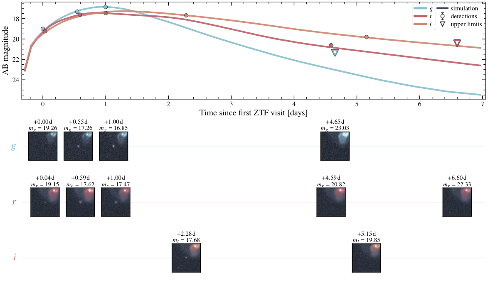

## 2026-10-05

1. [Comment on: "The Preprint Evolution: The Rise of Unreviewed Drafts on arXiv and its Implications for Astronomy"](https://arxiv.org/abs/2610.02273)

    > Astronomy, Publication

    这篇评论讨论按同行评审状态拆分 arXiv 天体物理论文流的建议，主张保留统一开放的交流渠道，并由读者借助筛选工具选择关注范围。论证结合科研经历，强调接收前公开稿件可扩大纠错与补充引用的反馈来源，建立可追溯的优先权记录，并让研究结果在期刊审稿期间及时传播。文章提出，天体物理期刊应要求论文在正式接收前至少公开于 arXiv 一周，为社区反馈留下时间。这一制度建议来自经验与规范性讨论，其对论文质量、阅读负担和公平性的实际影响仍需系统评估。

2. [Do Astronomical Foundation Models Know When They Will Fail?](https://arxiv.org/abs/2610.02613)

    > Astronomy, Machine Learning, Statistics

    研究用 Legacy Survey、HSC、JWST 的交叉匹配图像及 SDSS 光谱检验天文基础模型的跨巡天表征可靠性，通过简单回归映射与共形预测校准误差区域。AstroPT 在相近覆盖率下具有更低迁移误差和更紧的不确定区域，各模型家族失效的对象也有所不同。源表征对未来误差的预警在 Legacy 到 HSC 中稳定出现，在 HSC 到 JWST 中依赖模型，在 SDSS 到 HSC 中很弱。自适应校准使 AstroPT 最大模型最困难组的覆盖率从 86.3% 提升至 90.5%。覆盖保证依赖可交换性，各天体子群仍可能失准；[交叉匹配数据](https://huggingface.co/astro-conformal-project)已公开。

    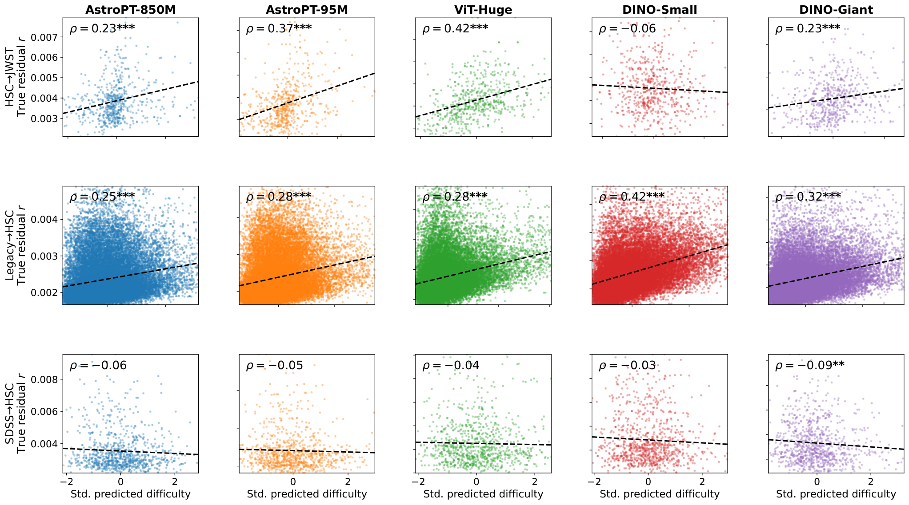

3. [A New Analysis Tool for Radial Pulsations](https://arxiv.org/abs/2610.02733)

    > Stellar, Pulsation, Theory

    研究从线性径向脉动方程推导波能量关系，将动能、声学势能、动力学势能和熵势能统一起来，追踪非绝热过程与表面能流对振荡的影响。对 10、20、30 个太阳质量的零龄主序星模型，计算基频至第十四泛音并分析能量分布。普通模的动能集中在内部空腔，满足近似能量均分；奇异模在表面附近振幅和动能急剧增长，并出现明显波能泄漏。20 个太阳质量模型的奇异模仍有 43.2% 动能位于内部空腔，说明其能量分布跨越内外空腔。数值应用采用绝热近似和给定表面边界条件，非绝热稳定性及开放边界的进一步分析仍待开展。

    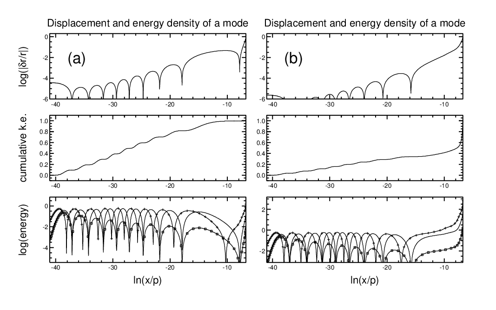

4. [The 2015-2017 Large EVPA Rotation in OJ 287: Dominant Propagating Component in a Helical Magnetic Field with Time-Dependent Viewing Geometry](https://arxiv.org/abs/2610.03044)

    > AGN, Polarization, Observation

    研究结合 KVN、ALMA、Metsähovi 射电监测与已发表的光学偏振数据，追踪 OJ 287 在 2012–2023 年的喷流变化。大幅平滑的电矢量位置角旋转集中于 2015–2017 年，毫米波旋转超过 300°，并伴随一系列峰值逐渐增强的耀发。ALMA 光变分解得到旋转期间的变异多普勒因子约为 8–11，整体保持近似稳定。偏振与同期 VLBI 结构共同支持新扰动沿螺旋磁场传播、依次增强准静止喷流结构，并在有利视角下暂时主导偏振辐射的解释。多普勒估计依赖模型假设，采样空缺也保留了局部偏振角展开歧义。

    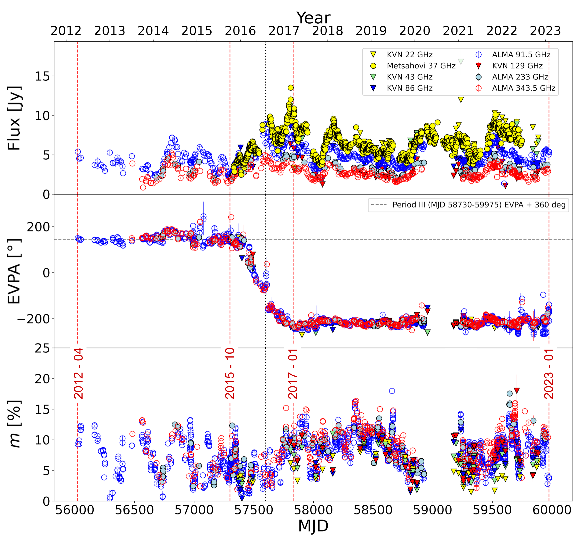

## 2026-10-06

1. [Shared Geometry Is Not Shared Physics: A Layerwise Test of the Platonic Representation Hypothesis in Astronomy](https://arxiv.org/abs/2610.04130)

    > Astronomy, Machine Learning, Method

    研究利用 36 个预训练模型及交叉匹配的光学、红外图像和光谱，逐层检验表征几何对齐与物理量预测的跨巡天迁移。校正网络深度搜索与多重检验后，139 组模型—巡天比较均在某一层出现显著局部邻域对齐，其强度随深度呈非单调变化。根据几何指标选层，在全部图像迁移任务中均逊于根据物理标签选层。HSC 与 COSMOS-Web 的 31 组末层表征全部几何对齐，直接跨巡天预测红移的 $R^2$ 却全部为负。结果适用于冻结表征与直接迁移的线性探针，支持对具体物理任务开展独立验证；非线性适配和联合训练仍需另行评估。

    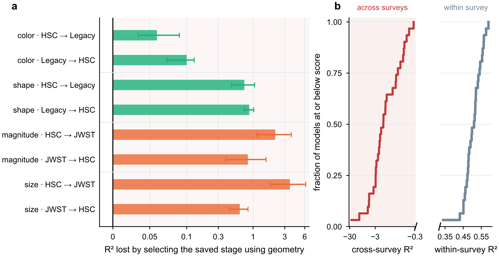

2. [The Robots are Coming: Artificial Intelligence Searching for Extraterrestrial Intelligence](https://arxiv.org/abs/2610.04449)

    > SETI, Machine Learning, Review

    综述总结 Breakthrough Listen 将人工智能用于射电与光学技术标志搜索的进展，涵盖窄带识别、异常检测、实时流处理和候选复核。机器学习重分析 820 颗邻星的档案得到八个新候选，再观测未复现这些信号。GLOBULAR 干扰聚类在既有搜索中将假阳性事件减少 99.3%，模拟信号回收率略低于经典方法。实时神经网络已能检测色散脉冲，多模态大语言模型辅助复核仍处于测试阶段。性能验证需同时检查候选压缩与信号遗漏，未知信号的搜索完备性依赖注入信号总体及跨望远镜验证。

    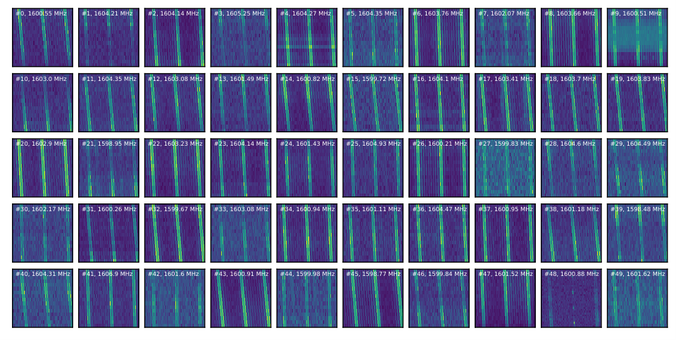

3. [Opportunity Lost in Searching for Technosignatures](https://arxiv.org/abs/2610.05085)

    > SETI, RFI, Radio

    研究结合公开卫星轨道与 MWA 档案，量化射电技术标志搜索因卫星空间占用、噪声升高及主动避频而损失的机会。代表性波束内的卫星空间占用随时间约增加两倍，增长幅度依赖指向。对 9594 次观测、约 330 小时资料的分析显示，半数阵列—频段组合出现显著干扰标记率上升，其余与零趋势相容。ORBCOMM 下行频率还呈现观测数量缺口。噪声与搜索体积预测依赖统一卫星发射假设，标记率同时受地面干扰和亮射电源影响；[处理管线](https://github.com/StevePrabu/MWA-RFIwatch)已公开。

    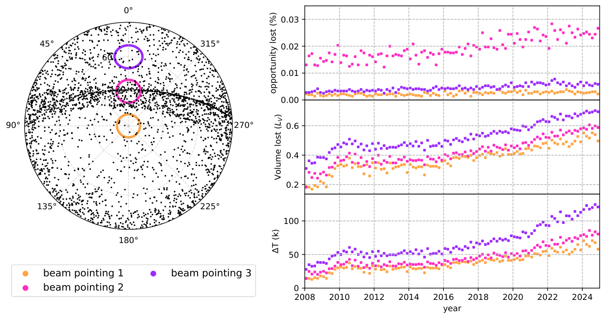

4. [Radiation Reaction in Relativistic Magnetized Shocks of Neutron Star Magnetospheres](https://arxiv.org/abs/2610.05386)

    > Fast Radio Burst, Magnetar, Simulation

    研究将辐射反作用加入定常多流体模型，并用一维粒子网格模拟检验强冷却对磁星磁层激波及相干前驱波的影响。激波结构由阿尔芬马赫数和冷却参数 $\tau$ 控制，相干辐射阈值随冷却增强而升高，强冷却下谱峰按 $\tau^{2/7}$ 上移。磁星模型中的怪物激波仍远高于阈值，驱动低频波转换为射电前驱波的能量比例约为 0.1%–1%，支持强冷却环境中的高频相干辐射。结果依赖一维几何与前驱波耦合假设，输出波离开耗散区后的传播和逃逸仍需进一步检验。

    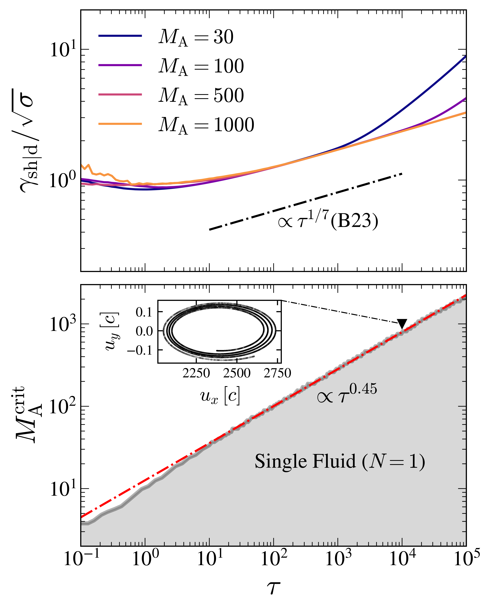

5. [AI Agents as a Research Team: A Human-Supervised Case Study in Stellar Spectroscopy](https://arxiv.org/abs/2610.05424)

    > Stellar, Spectrum, LLM

    研究记录人类监督下的恒星光谱研究案例，由协调器与八种专业代理承担计算、批评、文献、绘图和写作，并由研究者批准关键决策。CondGen 用大气与元素丰度标签预测合成光谱，在 21657 条测试光谱上的报告平均绝对误差为 0.003681。团队发现评估缩放器不匹配及冷星镁吸收响应反转，促成流程纠正与异常披露。该案例展示专业分工和批评如何连接科研环节。工作流证据来自回顾性摘要，效率收益缺乏受控比较；镁异常的物理解释仍需匹配合成参考光谱验证。

    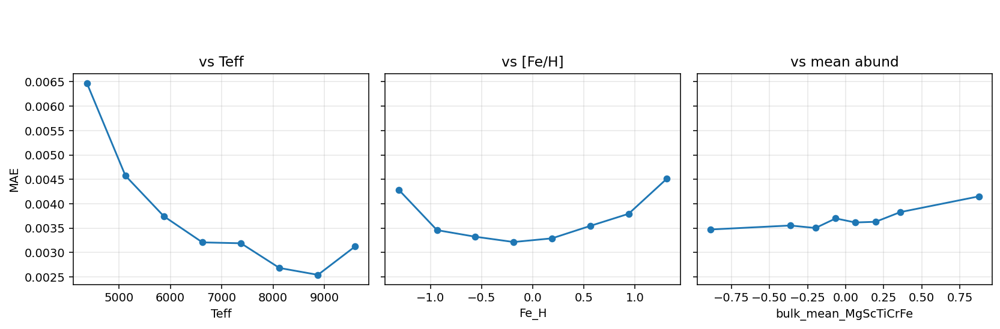

6. [ZTF J191814.28+010850.2: An eclipsing cataclysmic-variable candidate in the SW Sextantis period range](https://arxiv.org/abs/2610.05494)

    > Stellar, Binary, Observation

    研究结合 ZTF 双波段测光与 Chilescope 两夜观测，重新评估短周期食双星 ZTF J191814.28+010850.2 的性质。得到轨道周期 0.1408529(3) 天，主食深度在 g、r 波段分别约为 2.8、2.0 星等。排除主食并扣除轨道调制后，双波段保留宽缓变暗及部分恢复。深食、食外明显散布和短周期共同支持食激变星候选解释，并提示周期间变化。其周期处于 SW Sex 类常见范围，分类确认与吸积结构解释需要时间分辨光谱；额外测光可检验残余变化的来源。

    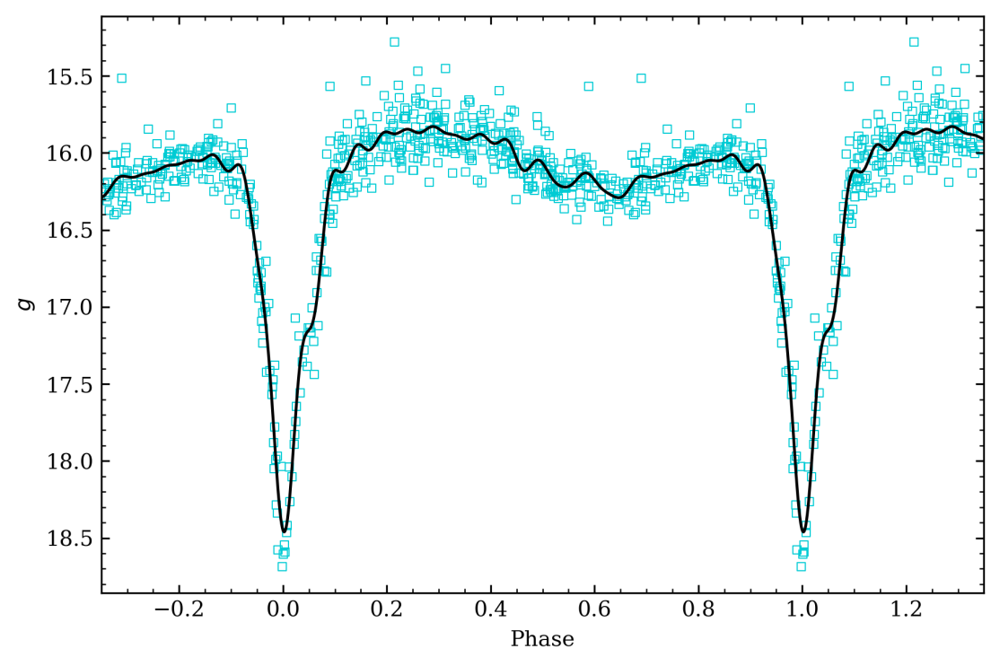

7. [Coherent radio bursts, polarity reversal, and quiescent emission from the M4V dwarf WW PsA](https://arxiv.org/abs/2610.05955)

    > Stellar, Radio, Polarization

    研究利用 ASKAP DINGO 巡天搜索近邻恒星的偏振射电辐射，并结合档案与 ATCA 随访分析年轻 M4V 星 WW PsA。在 283.3 小时数据中检出三次长时标爆发，扣除静态背景后均接近完全圆偏振，其中一次发生极性翻转；后续流水线另检出一次爆发。偏振与到达相位支持电子回旋脉泽及旋转调制解释，静态辐射具有回旋同步辐射特征。旋转解释依赖稀疏事件与光学周期，多个预期窗口未检出脉冲，斜转子模型推断的磁场几何仍待独立观测验证。

    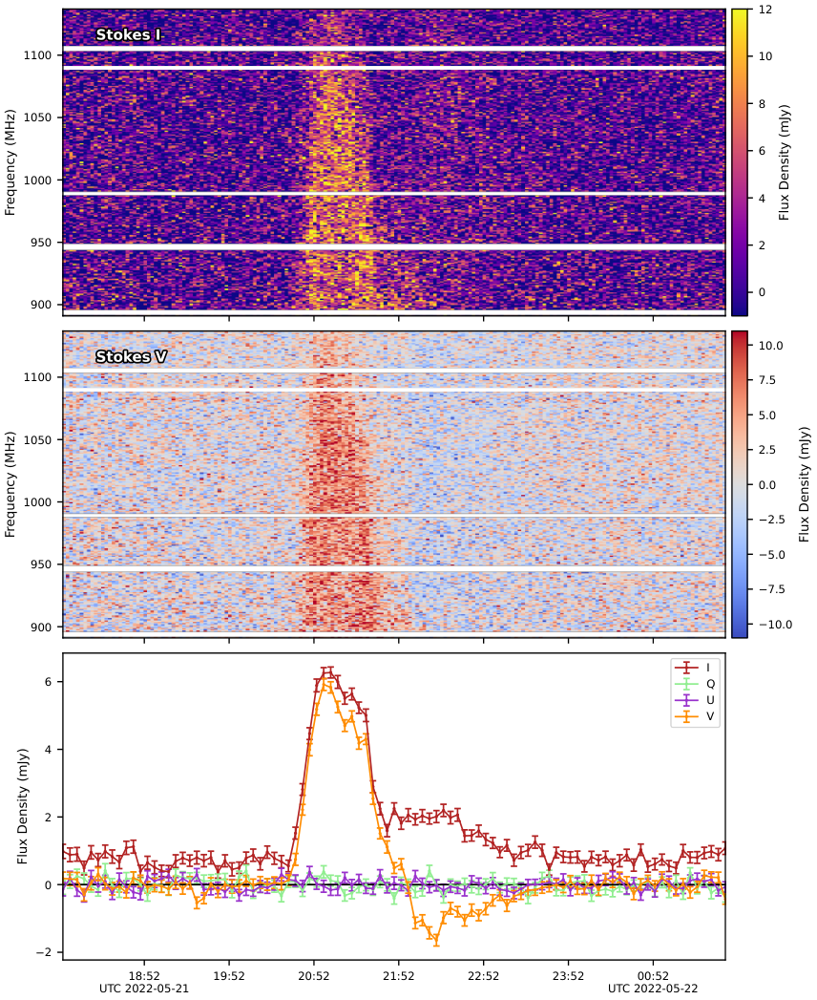

## 2026-10-07

1. [A Technosignature Survey Of The Anti-Solar Point: The SETI Institute's Largest-Ever Campaign With The Allen Telescope Array](https://arxiv.org/abs/2610.07065)

    > SETI, Radio, Survey

    ATA 反太阳点巡天将地球凌日几何作为潜在通信双方可共同识别的搜寻焦点，沿黄道搜索窄带、多普勒漂移的射电技术标志。观测用目标波束与偏离目标的参考波束比较信号强度，再经干扰过滤和人工形态检查筛选候选。阶段性有效指向覆盖约为完整计划的 12%，已标注频谱中有 25 张天空定位候选谱图，涉及 10 个待复观测位置。候选状态需要独立复现及干扰排查，观测、分析和标注仍在继续。频率屏蔽的调整与每次观测的绘图数量上限也会影响搜索完备性。

    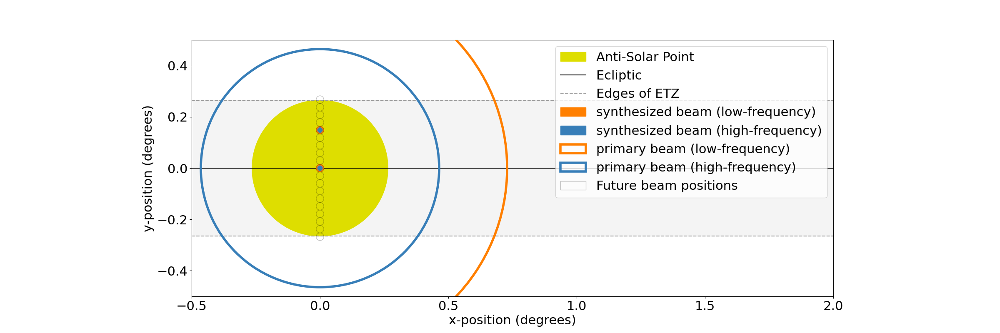

2. [Enhancing the Interpretability of Radial Velocity Analysis Using Leave-one-out Cross-validation](https://arxiv.org/abs/2610.07181)

    > Exoplanet, Radial Velocity, Statistics

    研究用留一交叉验证检验三个系外行星系统，逐点比较被留出观测的预测表现，并将重要性采样近似扩展到高斯过程相关噪声。HD 119130 b 的偏高质量主要受到两个测量点推动，移除后与多仪器结果的张力降低。GJ 4276 的偏心单行星模型具有更佳预测表现，逐点差异还给出优先补测的轨道相位。GJ 357 增加第四候选信号后的预测改善仅为标准误的 0.20 倍，支持保留三行星解释。相关时序中的邻点插值与噪声模型选择仍限制结论；[公开教程](https://github.com/mcnixon/rv_loo_cv_tutorial)提供实现示例。

    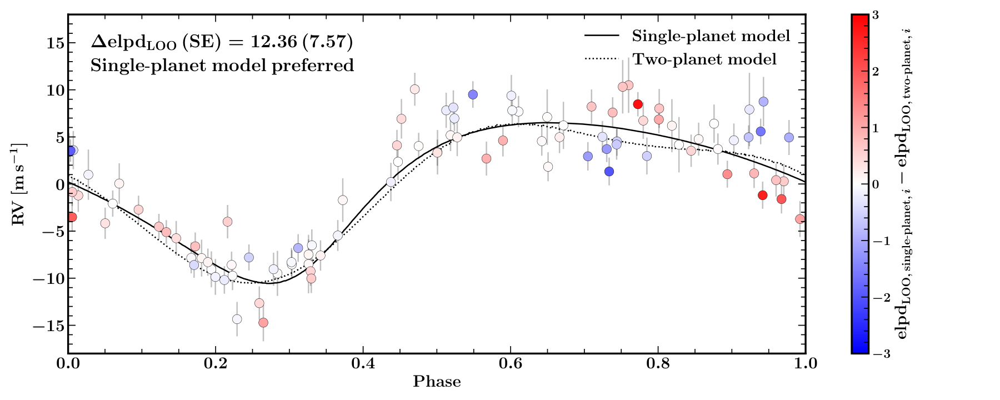

3. [A spatially resolved view of Fast Radio Burst host metallicities with Integral-field Spectroscopy](https://arxiv.org/abs/2610.07325)

    > Fast Radio Burst, Host Galaxy, Metallicity

    研究利用 Magellan/LLAMAS 积分场光谱及 Keck 档案，测绘五个已定位、尚未观测到重复爆发的 FRB 宿主，以 O3N2 指标比较爆发位置与宿主整体的气相金属丰度。宿主内部的丰度分布跨度约为 0.1–0.4 dex，各爆发位置也呈现明显差异；其中一处显著高于宿主中位值，另一处因氮线未检出仅得到上限。所有爆发位置附近均有 Hα 辐射，支持与近期恒星形成的关联。结果说明长缝光谱估计会受到取样区域和丰度标定影响。小样本、有限空间覆盖及局域测量上限限制了对 FRB 金属丰度偏好的统计判断。

    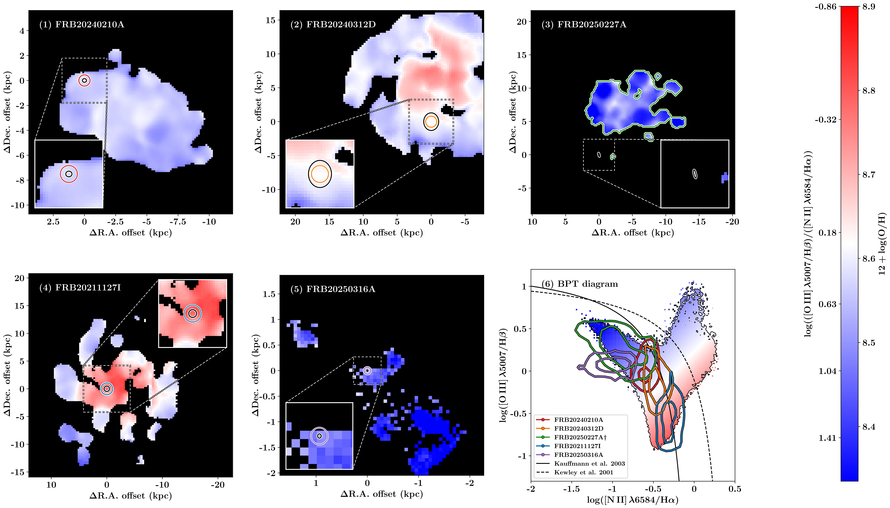

4. [The First Decade of Breakthrough Listen](https://arxiv.org/abs/2610.07482)

    > SETI, Radio, Review

    综述从设施与仪器角度总结 Breakthrough Listen 首个十年的技术演进，涵盖宽带电压记录、信号处理、数据档案与望远镜合作。项目经历定向观测、网络扩展和自主共用观测阶段，商用 GPU 与标准网络使技术标志搜索能够并行利用常规观测数据。MeerKAT 已完成超过 120 万个可用于搜索的指向，全球存储容量约为 42 PB。旅行者探测器与 JWST 通信信号用于验证系统，脉冲星和恒星耀发提供附加科学检验。经验强调开放数据、干扰诊断和预先建立候选验证流程。已知信号检验覆盖具体处理链路，未知技术信号的探测完备性仍需独立评估。

    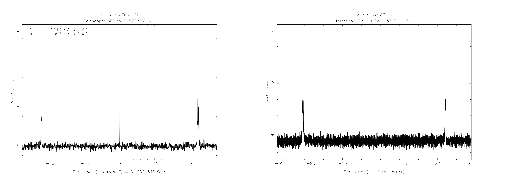

5. [Probing turbulence in the ionized interstellar medium using young pulsars. I. Dispersion measure variations](https://arxiv.org/abs/2610.08318)

    > Pulsar, ISM, Turbulence

    研究结合 Parkes 多波束与超宽带接收机资料，分析 364 颗年轻脉冲星在 18 年中的色散量变化，以逐历元到达时刻拟合和结构函数探测电离星际介质的电子密度涨落。超宽带数据中有 89 颗呈显著长期趋势，多数获得有效谱指数约束的视线与 Kolmogorov 湍流相容，部分超新星遗迹附近视线的涨落幅度增强。研究同时发现，本征脉冲形状变化、脉冲抖动及散射延迟可污染色散量估计。谱指数误差较宽，结构函数模型也省略了确定性梯度项，普遍湍流谱的结论保持暂定。

    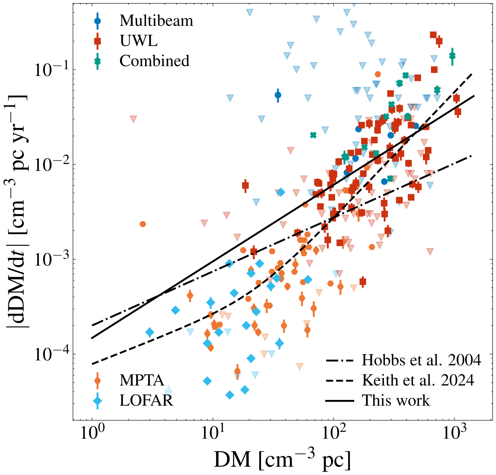

## 2026-10-08

1. [ASTRAL: A Framework for Optimal Placement and Emulation of Stellar Evolution Models](https://arxiv.org/abs/2610.09531)

    > Stellar, Machine Learning, Software

    ASTRAL 以高斯过程模拟恒星演化输出，并依据预测不确定性安排新增计算，改善有限模拟预算下的参数空间取样。框架结合 KEPLER 与 MESA 模型，以铁核质量的不确定性作为布点指标；在同为 65 个模型的一维 MESA 对比中，优化布点的平均预测不确定性较均匀布点低约 25%。按铁核质量选择超新星模拟，还使平台期光度的预测不确定性降低约 30%，显示布点收益可传递至相关下游量。物理验证集中于单一初始质量维度和简化模型，预测误差的改善仍需独立检验。[代码](https://github.com/astrobarker/astral-gp)已公开。

    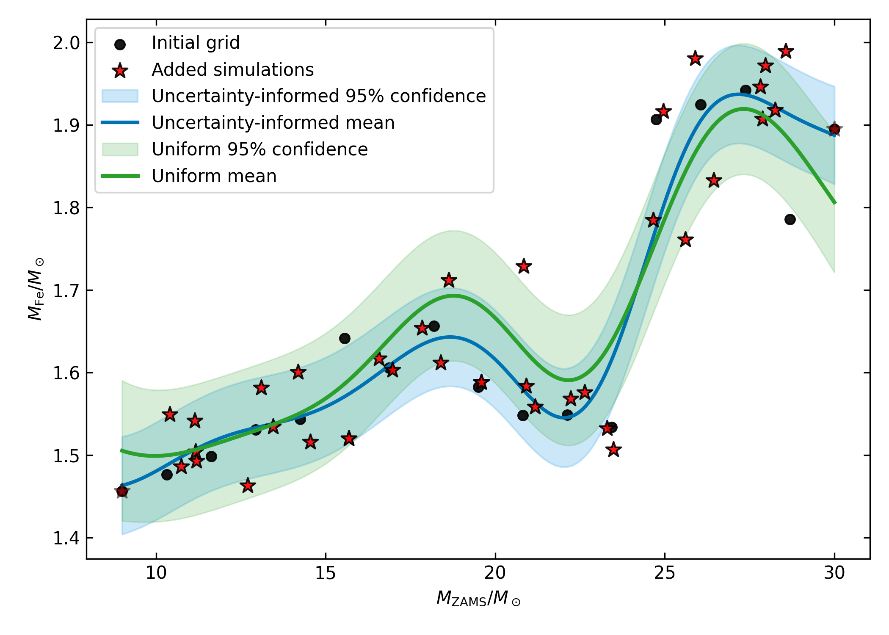

## 2026-10-09

1. [A Multi-dimensional Analysis of the Open Clusters NGC 2423 and NGC 2482 with Gaia DR3](https://arxiv.org/abs/2610.10683)

    > Stellar, Gaia, Kinematics

    Gaia DR3 的测光、视差与自行数据统一刻画疏散星团 NGC 2423 和 NGC 2482，并检验它们与毕星团星流的运动学联系。UPMASK 筛选成员并施加天体测量质量控制后，PARSEC 等时线拟合给出约 1.25 和 0.445 Gyr 的年龄；视差与测光距离相互一致。视向速度、速度椭球和银河轨道分析显示，两团均沿近圆薄盘轨道运动，NGC 2423 呈现质量分层。NGC 2482 与毕星团星流的速度对应更紧密，NGC 2423 的银河径向运动分量 $U$ 存在偏移。角动量重叠为动力学关联提供线索；静态轴对称势下的轨道结果对银河棒共振俘获仍缺少直接检验。

    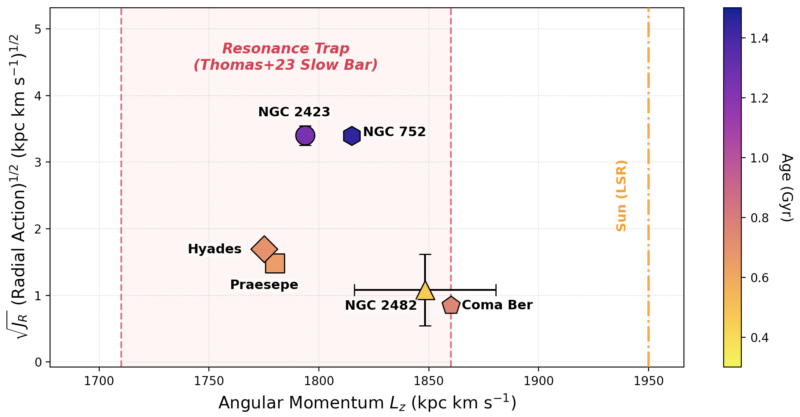

2. [Atypical White Dwarfs in Open Clusters](https://arxiv.org/abs/2610.10699)

    > White Dwarf, Magnetic Field, Stellar

    疏散星团的已知年龄为特殊白矮星的前身星与形成通道提供约束。文献汇编与档案光谱筛选建立 18 颗氦线、无特征谱或磁性白矮星样本，结合光谱、宽带测光和冷却模型，与星团氢大气白矮星及场星比较。氦大气样本的初始—最终质量关系、空间和运动学分布与氢大气样本相容。星团在 $0.8–1.0\,M_\odot$ 区间缺少非氢大气白矮星，场星模型得到零颗的概率为 0.37%；高质量热磁性白矮星同样偏少。场星长期积累延迟并合遗迹可解释这些差异，解释仍受小样本及质量、温度选择效应影响。[已发表的比较样本数据](https://wdifmr.org)可下载。

    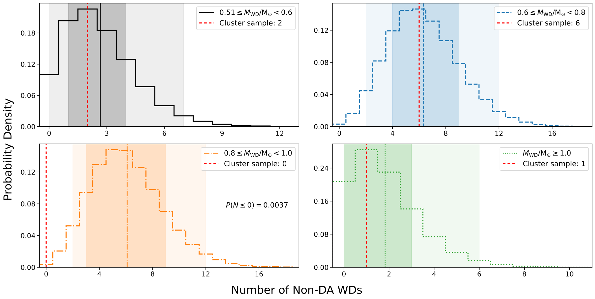

3. [Feedback-Conditional 3D Reconstruction of Cosmic Baryons with Flow Matching](https://arxiv.org/abs/2610.10741)

    > Fast Radio Burst, Cosmology, Machine Learning

    流匹配生成模型从星系分布重建宇宙气体的三维后验，并沿视线积分预测快速射电暴的色散量。模型以 CAMELS50 的 IllustrisTNG 模拟训练，输入包含红移空间星系密度、宇宙学参数、星系质量门槛和重子功率谱抑制，显式追踪反馈对气体分布的影响。代表性测试盒中，重建与真实色散量的秩相关系数为 0.857；增强反馈使气体更弥散，减弱反馈拓宽色散量分布。全卷积网络还能处理更大体积。大盒测试的绝对色散量存在约 0.17 dex 偏移并经过归一化校正，稀疏星系样本的后验仍偏窄；验证集中于零红移同一模拟物理，真实巡天选择效应仍需校准。

    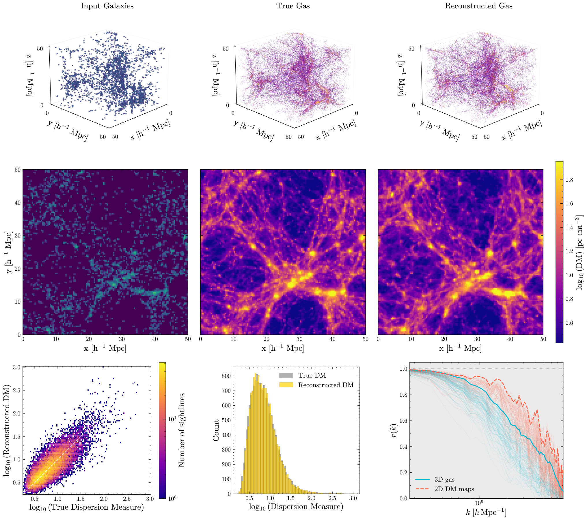

4. [Primordial black holes](https://arxiv.org/abs/2610.10750)

    > Cosmology, Black Hole, Review

    原初黑洞综述系统梳理早期宇宙中的形成机制、后续聚集与可观测信号，重点推导闭合畴壁坍缩以及额外空间维度中的引力真空模型。暴胀期的场涨落可产生分层黑洞团簇，团簇动力学抑制早期双星的并合，同时增强后期俘获通道，从而改变并合率的红移演化和引力波背景。微引力透镜、宇宙微波背景、恒星系统动力学及蒸发辐射共同限制其暗物质占比，约束强度依赖质量函数、聚集状态和吸积假设。现有异常天体现象保留多种起源解释，可靠的原初黑洞确认仍需独立证据。

    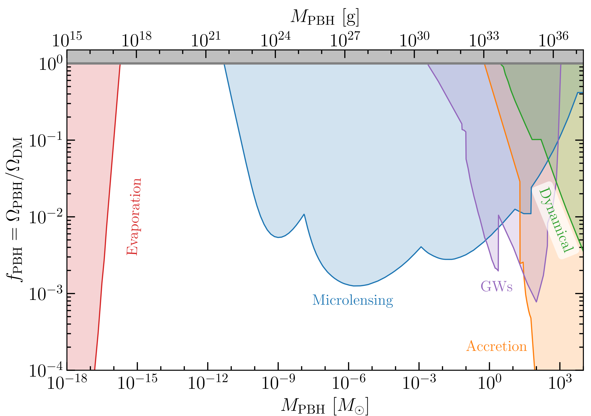

5. [radio-astro-tools: linking radio astronomical data to the astronomical Python ecosystem](https://arxiv.org/abs/2610.11429)

    > Radio, Spectrum, Software

    radio-astro-tools 将射电谱线立方体和 CASA 格式接入 Astropy 生态。核心 spectral-cube 通过惰性分块与并行计算处理超过内存容量的数据，统一坐标、单位、掩膜和逐通道波束；配套工具支持波束匹配、位置—速度图提取及单碟与干涉图像的短间距合并。合成数据测试中，uvcombine 与 CASA feather 的合并结果一致。交互教程覆盖谱线拟合、矩图和重投影。适用性取决于分块策略与数据校准，谱线模型拟合由配套软件承担。[教程与示例](https://radio-astro-tools.github.io/tutorials/)已公开。

    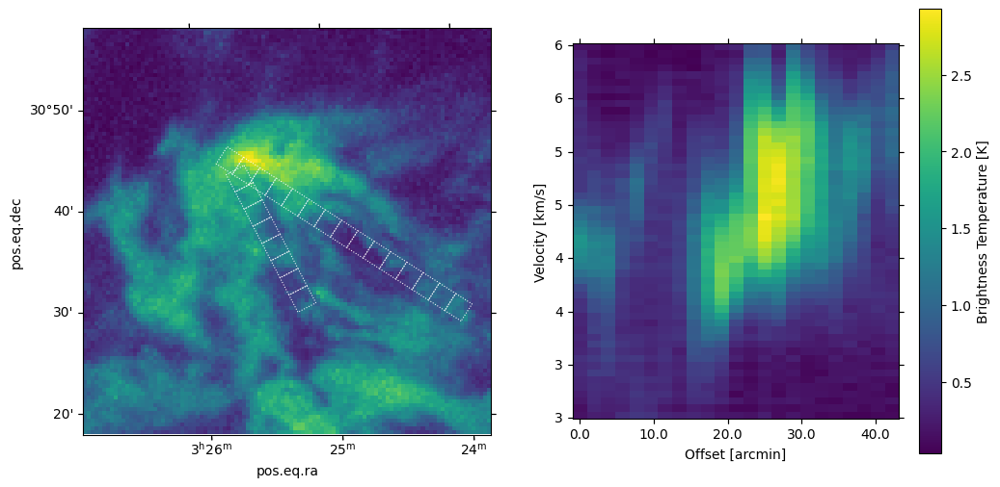

6. [A Coherent Harmonic Summing Pulsar Search Code](https://arxiv.org/abs/2610.11749)

    > Pulsar, Software

    CoherentSearch.jl 在傅里叶域保留谐波振幅与相位，通过插值和逆变换重建各试探频率的脉冲轮廓，再用不同宽度的箱形模板检验周期信号。局部白化后的频谱提供解析噪声方差，使不同频率和轮廓分辨率共享可校准阈值，并支持多核与 GPU 并行。在每次模拟观测平均 0.1 个误报的统一标准下，白噪声注入回收率约为 76%，PRESTO 非相干搜索约为 42%；与快速折叠算法的比较依赖折叠配置。红噪声下阈值稳定依赖频谱白化，模拟评估的范围覆盖无射频干扰、无轨道加速的信号。[代码](https://github.com/scottransom/CoherentSearch.jl)已公开。

    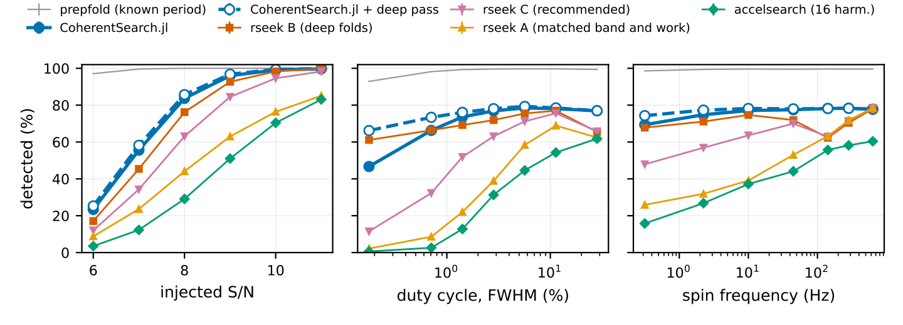

7. [A New Era for Supernova Science with the James Webb Space Telescope](https://arxiv.org/abs/2610.12100)

    > Supernova, JWST, Review

    JWST 的近红外与中红外观测拓展了超新星尘埃生产、爆炸前身和宇宙学研究。这篇综述汇集近邻超新星的分子与尘埃光谱、Ia 型爆炸的稳定镍特征，以及高红移和强透镜样本。JADES 已发现 79 颗超新星，透镜放大的 SN Eos 则在红移 5.13 获得光谱分类。强透镜时间延迟提供独立的哈勃常数测量，高红移 Ia 型样本开始检验光度演化。总体演化结论仍受小样本与选择效应限制；未来 Roman 的广域发现将与 JWST 的精细光谱互补。相关观测可在 [MAST](https://mast.stsci.edu/portal/Mashup/Clients/Mast/Portal.html) 查询。

    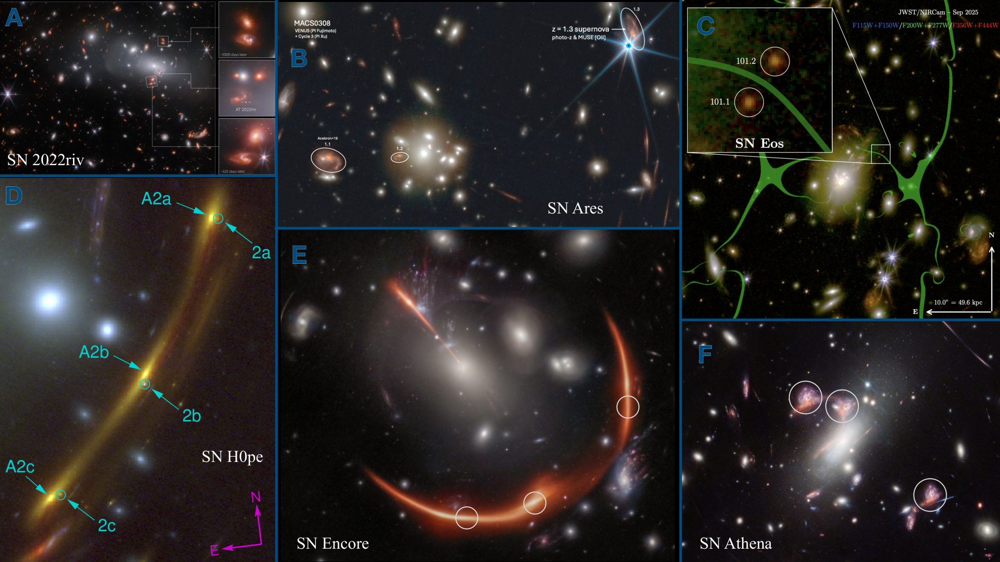

8. [EWOCS-XI: Anisotropic expansion and shear in the cluster Westerlund 1. A 2D kinematic analysis with Gaia DR3](https://arxiv.org/abs/2610.12117)

    > Stellar, Gaia, Kinematics

    Gaia DR3 的位置、自行和距离聚类用于辨认 Westerlund 1 成员，二维速度梯度模型进一步分解星团的整体运动、膨胀和剪切。在 524 颗高质量成员中，103 颗的投影内部速度显著超过模型逃逸速度，形成正在逃离的外围群体；束缚核心保持接近动力学平衡。整体速度场呈现以垂直银盘方向为主的各向异性膨胀，并带有显著交叉梯度。膨胀时标约为两百万年，与回溯所得的银盘穿越时间吻合。这一时间对应关系为触发机制提供约束，内部反馈、恒星相互作用和外部潮汐影响仍需后续观测区分。

    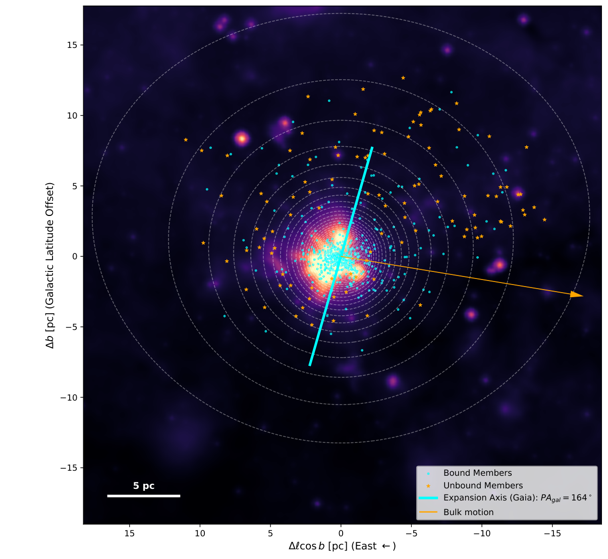

9. [Discovery of the Slowest Radio Pulsar in the Small Magellanic Cloud](https://arxiv.org/abs/2610.12143)

    > Pulsar, Radio, Survey

    重新处理 Parkes 对小麦哲伦云超新星遗迹和脉冲星风云的定向档案，在两次独立观测中检出 PSR J0103−72。其自转周期为 1.327 秒，色散量为 $272\pm13\,\mathrm{pc\,cm^{-3}}$，成为目前小麦哲伦云最慢的已知射电脉冲星。搜索依据周期和谐波数调整傅里叶候选门槛，再结合折叠与跨历元验证，保留了弱谱域信号中的真实脉冲。较高色散量可由较长的电离介质路径或局部高密度气体解释，精确定位将帮助区分这些来源。既往漏检原因仍有不确定性，射频干扰、候选筛选和巡天覆盖共同影响搜索完备性。

    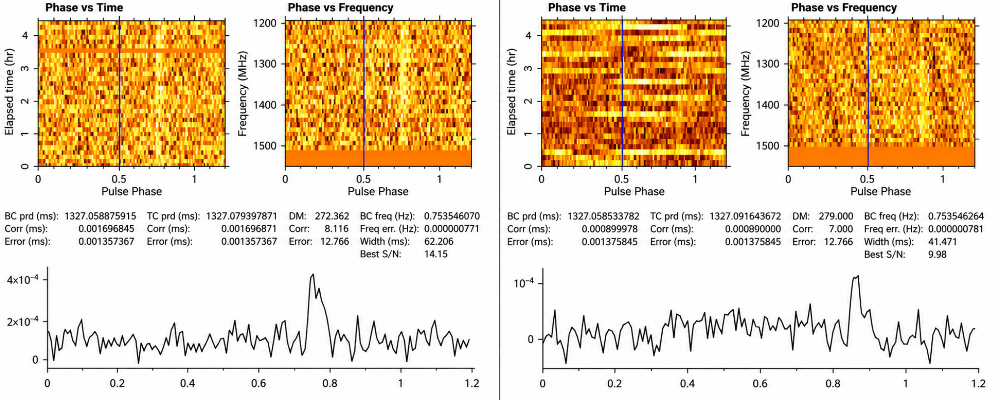

10. [Opening the Black Box: What Neural Networks Learn from Pulsar Timing Array Data](https://arxiv.org/abs/2610.12308)

    > Pulsar, Gravitational Wave, Machine Learning

    研究以二维脉冲星计时阵列玩具模型，解释神经网络识别引力波背景各向异性的统计依据。模型包含 50 颗脉冲星，将计时残差压缩为相关矩阵，并用可直接计算的贝叶斯因子检验线性分类器和多层感知机。参数固定时，两类网络均达到最优检出表现；对未知各向异性参数作对称先验边缘化后，非线性网络仍接近贝叶斯结果，线性网络退化至随机判别水平。交叉熵训练使网络学习架构能够表示的对数贝叶斯因子近似。验证采用规则采样、白噪声和已知噪声幅度，真实计时数据的适用性仍需检验。[复现代码](https://github.com/Mauropieroni/PTAs_in_flatland)已公开。

    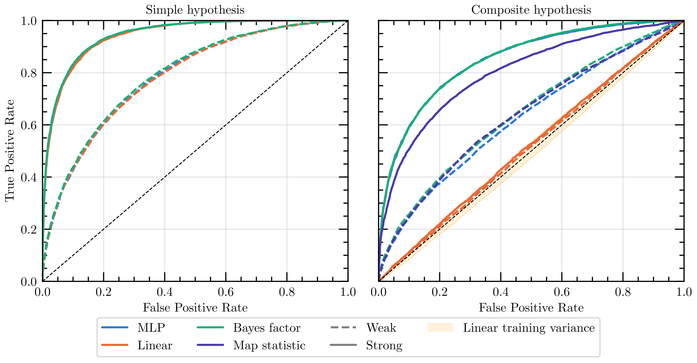

11. [Discovery of Hidden Extragalactic Pulsars in the Parkes Archival Data](https://arxiv.org/abs/2610.12450)

    > Pulsar, Survey, Radio

    研究重处理 Parkes 麦哲伦云巡天档案，以深谐波累加、低信噪比候选保留和优化折叠寻找遗漏的弱脉冲星，并用快速折叠搜索交叉检验。结果报告五个与大麦哲伦云位置及色散量相符的新源，另有银河系前景脉冲星；大麦云已知射电脉冲星总数增至 49。其中自转周期约 3.8 秒的源成为麦哲伦云中已知最慢的射电脉冲星，部分源呈现消零或闪烁。光度和占空比分析显示与银河系普通脉冲星的总体相近特征，支持进一步深搜档案。一个大麦云源仍缺独立后续确认，低信号下的消零与闪烁区分也保留不确定性。

    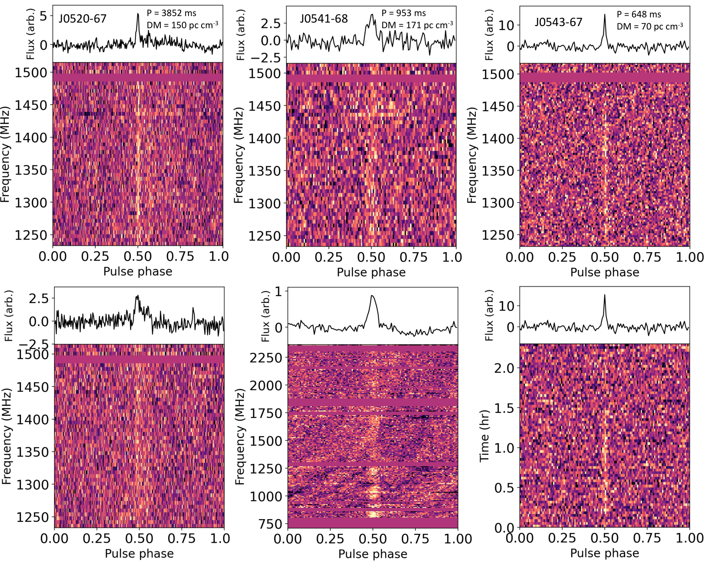
